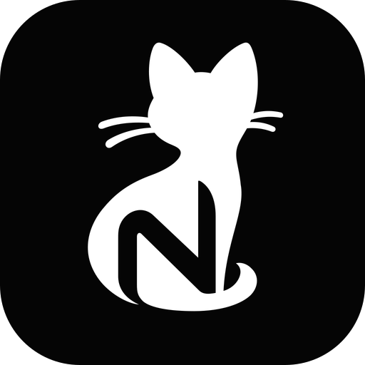
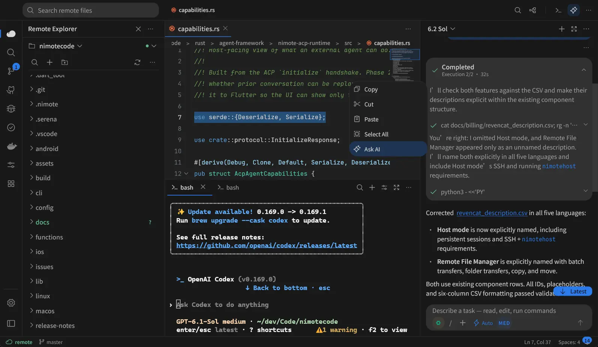

<p align="center"></p>

<h1 align="center">NimoteCode — IDE móvil para Android e iOS</h1>

<p align="center"><a href="README.md">English</a> · <a href="README.zh-CN.md">简体中文</a> · Español · <a href="README.ja.md">日本語</a> · <a href="README.ko.md">한국어</a></p>

<p align="center"><strong>Tus proyectos, en tu teléfono o tableta.</strong><br>Abre proyectos locales o conéctate por SSH. Edita código, ejecuta comandos, revisa cambios de Git y trabaja con IA en un solo espacio móvil.</p>

<p align="center"><sub>Editor de código&nbsp;&nbsp;•&nbsp;&nbsp;Terminal SSH&nbsp;&nbsp;•&nbsp;&nbsp;Git&nbsp;&nbsp;•&nbsp;&nbsp;Programación con IA<br>Ubuntu sin root en dispositivos Android compatibles</sub></p>

<p align="center"><a href="https://play.google.com/store/apps/details?id=com.nimote.nimotecode"></a> <a href="https://apps.apple.com/app/nimotecode-ssh-client-ide/id6776158253"></a></p>

<p align="center"><sub><a href="#workspace-demo">Demo</a> · <a href="https://nimotecode.com/es/docs/quick-start">Inicio rápido</a> · <a href="https://nimotecode.com/es/releases/2.4.0">Novedades</a></sub></p>

<p align="center"><sub>Gratis para empezar; configurar la IA es opcional. Aplicación comercial de código cerrado · Documentación y recursos oficiales.</sub></p>

<p align="center"></p>

<a id="workspace-demo"></a>

## Demo

La imagen muestra el Agente de IA en un teléfono y el espacio SSH en una tableta. [Abre el video de demostración](https://github.com/user-attachments/assets/df7de976-e743-415d-9bd1-df396a647e10).

<div align="center">
  <video src="https://github.com/user-attachments/assets/df7de976-e743-415d-9bd1-df396a647e10" controls muted playsinline width="420"></video>
</div>

## Desarrolla donde esté tu proyecto

- **Proyecto local:** abre una carpeta con el selector del sistema y empieza a editar.
- **Host de desarrollo por SSH:** trabaja con archivos remotos, terminal y cambios de Git en el mismo espacio.
- **Linux local en Android:** usa Ubuntu, Bash, Git y SSH mediante PRoot en Android compatible; los proyectos locales se comparten en `/mnt/local`.

Local Linux requiere Android 8 o posterior en dispositivos ARM64 / x86_64 compatibles; no está disponible en iPhone ni iPad. Un host SSH debe estar configurado y ser accesible.

## Capacidades principales

- **Cambia de modo:** alterna entre IDE, Terminal e IA conservando el proyecto y el estado del explorador.
- **Desarrolla con contenedores:** administra Docker y Compose en un host SSH, o crea y reconstruye un Dev Container desde `devcontainer.json`.
- **Edita y navega:** usa Nimote Editor en teléfono, tableta y escritorio; busca archivos, usa paneles divididos y previsualiza Markdown y contenido web.
- **Ejecuta y verifica:** usa terminal, tareas de proyecto, teclas adicionales móviles, modo de enfoque, paletas de terminal y proxies SSH SOCKS5 o HTTP CONNECT.
- **Revisa con Git:** consulta estado, diferencias e historial; busca, crea y cambia ramas desde el encabezado de Git.
- **Amplía el espacio de trabajo:** el Centro de plugins de Early Access permite paneles, formularios, flujos, vistas de resultados y tareas de script locales o SSH.

- **Herramientas de lenguaje:** conecta servidores compatibles para diagnósticos y adaptadores de depuración remotos configurados. LSP y depuración son flujos de Early Access que requieren las herramientas del entorno.
- **Carpetas externas:** las carpetas autorizadas por el sistema permiten explorar y editar; Git, LSP, depuración, tareas, vigilancia de archivos y Agent requieren una ruta nativa.
- **Disponibilidad:** las herramientas dependen del espacio de trabajo, las herramientas instaladas y el plan. Consulta la [referencia de funciones](https://nimotecode.com/es/features?utm_source=github&utm_medium=referral&utm_campaign=readme&utm_content=es_features).


## IA para programar a tu manera

| Flujo | Uso |
| --- | --- |
| **AI Chat** | Explica código y salida de terminal con contexto del espacio de trabajo; conecta tu propio proveedor y clave API. |
| **Agente integrado** | Inspecciona archivos, planifica cambios, edita y ejecuta verificaciones; añade instrucciones a una ejecución activa y responde preguntas interactivas. Disponible en Early Access. |
| **Servidores MCP** | Configura servidores MCP verificados para el Agente integrado en un espacio local o SSH; cada llamada requiere aprobación explícita. |
| **Agente ACP externo** | Conecta un entorno compatible en tu host SSH y revisa permisos y progreso en la conversación de la aplicación. |
| **Claude Code / Codex por SSH** | Ejecuta la CLI instalada en tu propio host desde el terminal. |

El acceso a modelos y los tokens no están incluidos. Los agentes externos y las CLI requieren instalación, autenticación y acceso propios; Claude Code y Codex no están incluidos. Revisa comandos y diferencias antes de aceptar cambios generados por IA.

## Empezar

1. Instala NimoteCode desde [Google Play](https://play.google.com/store/apps/details?id=com.nimote.nimotecode) o la [App Store](https://apps.apple.com/app/nimotecode-ssh-client-ide/id6776158253).
2. Abre un proyecto local, conecta un host SSH o explora el espacio Demo.
3. Haz un cambio pequeño, ejecuta una comprobación disponible y revisa la diferencia de Git.

> [Guía de inicio rápido →](https://nimotecode.com/es/docs/quick-start?utm_source=github&utm_medium=referral&utm_campaign=readme&utm_content=es_quick_start)

**Gratis para empezar, con flujos avanzados en Early Access:** Gratis incluye espacios locales y SSH, editor, terminal básico, revisión de Git, AI Chat y tareas básicas. integración con GitHub, Android Local Linux, Agent, búsqueda remota, varios terminales, escritura Git, LSP y depuración se ofrecen mediante Early Access. Consulta [Early Access](https://nimotecode.com/es/pro?utm_source=github&utm_medium=referral&utm_campaign=readme&utm_content=es_plans) y la aplicación para la disponibilidad y condiciones actuales.

La disponibilidad en tiendas y el momento de lanzamiento pueden variar por plataforma y región. Consulta [descargas y requisitos de plataforma](https://nimotecode.com/es/download?utm_source=github&utm_medium=referral&utm_campaign=readme&utm_content=es_download).

## Descargas

Descarga para Android en [Google Play](https://play.google.com/store/apps/details?id=com.nimote.nimotecode) o para iPhone y iPad en la [App Store](https://apps.apple.com/app/nimotecode-ssh-client-ide/id6776158253).

[Modo Host: Instalar NimoteHost, conectar por SSH y retomar terminales y tareas Agent.](https://nimotecode.com/es/docs/host)

## NimoteCode 2.4.0 · Host, tareas de proyecto y fiabilidad remota

- **Espacio Host.** Instala e inicia NimoteHost compatible en la máquina remota y conecta por SSH para buscar, fijar y retomar sesiones de terminal y Agent. Host es opcional.
- **Colaboración Agent.** Sesiones compatibles de Codex, Claude y OpenCode con conversaciones estructuradas, herramientas, aprobaciones, comandos, modelos e indicaciones durante la ejecución. Las políticas dependen del Host; las acciones sensibles pueden requerir aprobación.
- **Bandeja de tareas e Issues de GitHub.** Revisa estados, evidencias de verificación y diffs; continúa o archiva tareas y envía Issues según la política de publicación elegida. Depende de la versión y configuración del Host.
- **Plugins Host.** Accede desde la barra lateral a formularios versionados, tablas paginadas, detalles y vistas interactivas con controles de permisos.
- **Tareas de proyecto.** Descubre tareas compatibles de package.json, Taskfile, Makefile, justfile y .vscode/tasks.json y ejecútalas en el terminal. El descubrimiento dinámico de Make/just requiere confirmación.
- **Avisos y editor.** Configura avisos de finalización, confirmación y error, sonido y vibración sujetos al sistema, números de línea y minimapa horizontal. Pro se activa por defecto en Windows.
- Configuración unificada de funciones, paneles y plugins; avisos en la configuración Agent. Mejoras para tablets, Windows, colores horizontales y movimiento reducido.
- Filtra CI de GitHub por rama y flujo; consulta logs por paso, contexto de errores y avisos de descarga incompleta.
- Mayor respuesta del terminal, actualizaciones sincronizadas, búsqueda, desplazamiento, Vim, portapapeles, pegado en Windows y teclado virtual.
- Historial más fiable con eliminación local sin conexión; guardado remoto con motivos de error, edición de archivos grandes y diffs ajustados con navegación inferior.

[2.4.0 →](https://nimotecode.com/es/releases/2.4.0)

## Documentación

- [Inicio rápido](https://nimotecode.com/es/docs/quick-start) · [SSH](https://nimotecode.com/es/docs/ssh) · [Terminal](https://nimotecode.com/es/docs/terminal) · [Editor](https://nimotecode.com/es/docs/editor)
- [AI Chat & Agent](https://nimotecode.com/es/docs/ai) · [Control de código](https://nimotecode.com/es/docs/source-control) · [LSP](https://nimotecode.com/es/docs/lsp) · [Depuración](https://nimotecode.com/es/docs/debug)
- [Docker](https://nimotecode.com/es/docs/docker) · [Plugins](https://nimotecode.com/es/docs/plugins) · [Seguridad](https://nimotecode.com/es/docs/security) · [Índice](https://nimotecode.com/es/docs)

### Guías y recursos

- [Sitio oficial](https://nimotecode.com/es/?utm_source=github&utm_medium=referral&utm_campaign=readme&utm_content=es_website)
- [Funciones](https://nimotecode.com/es/features?utm_source=github&utm_medium=referral&utm_campaign=readme&utm_content=es_features)
- [Documentación de Linux local](https://nimotecode.com/es/docs/local-linux)
- [Guías de desarrollo móvil](resources/README.md) — edición local, desarrollo remoto, Git y flujos de IA (en inglés).
- [Preajustes de Linux](https://github.com/mobiledevloperlab/nimote-linux-presets) — entornos opcionales con manifiestos versionados y scripts de verificación.

## Preguntas frecuentes

**¿En qué se diferencia de Termux, Acode y code-server?** NimoteCode reúne editor táctil, cliente SSH, terminal, Git e IA en una aplicación móvil, con Local Linux opcional en Android. Termux se centra en la terminal y los paquetes de Android; Acode es un editor móvil; code-server ejecuta VS Code en el navegador.

**¿Necesito un servidor SSH?** No. Puedes abrir una carpeta local o el espacio Demo. Para usar SSH necesitas un host configurado y accesible.

**¿Puedo ejecutar código en el teléfono?** Los dispositivos Android compatibles pueden usar Local Linux. En iPhone y iPad puedes usar un host remoto por SSH. La ejecución depende de las herramientas instaladas.

**¿Está incluida la IA?** La configuración es opcional. Debes aportar tu proveedor y clave API; el uso del modelo puede tener costes adicionales. El Agente integrado requiere Early Access.

**¿Es de código abierto?** La aplicación es comercial y de código cerrado. Este repositorio contiene documentación y recursos.

[Más preguntas frecuentes](https://nimotecode.com/es/docs/faq).

## Compara herramientas móviles

**Editar → ejecutar verificaciones → revisar diferencias → ampliar el espacio de trabajo, en un solo IDE móvil.** La columna de NimoteCode refleja 2.4.0; `?` significa que la capacidad no se ha verificado para ese producto.

| Capacidad | **NimoteCode** | Termius | Blink Shell | ServerCC |
| --- | :---: | :---: | :---: | :---: |
| Conexión SSH | ✅ | ✅ | ✅ | ✅ |
| Editor de código | ✅ | ? | ✅ | ? |
| Plugins / paneles personalizados | ✅ ¹ | ? | ? | ? |
| Git / interfaz de diferencias | ✅ ¹ | ? | ◐ | ✅ |
| Ramas de Git | ✅ ¹ | ? | ? | ? |
| Agente de IA integrado | ✅ ¹ | ? | ? | ? |
| Continuar un Agente de IA activo | ✅ ¹ | ? | ? | ? |
| Servidores MCP integrados | ✅ ¹ | ? | ? | ? |
| Diagnósticos LSP | ✅ ¹ | ? | ◐ | ? |
| Vista previa web / de aplicación | ✅ | ? | ? | ✅ |
| Proxy SSH SOCKS5 / HTTP CONNECT | ✅ | ? | ? | ? |
| Linux local de Android | ✅ ² | ? | ? | ? |
| Transporte Mosh | ? | ✅ | ✅ | ? |

<details><summary>Comparar Redock, Orca y Moshi</summary>

| Capacidad | **NimoteCode** | Redock | Orca | Moshi |
| --- | :---: | :---: | :---: | :---: |
| Conexión SSH | ✅ | ✅ | ◐ | ✅ |
| Editor de código | ✅ | ? | — | ? |
| Plugins / paneles personalizados | ✅ ¹ | ? | ? | ? |
| Git / interfaz de diferencias | ✅ ¹ | ? | ✅ | ✅ |
| Ramas de Git | ✅ ¹ | ? | ? | ? |
| Agente de IA integrado | ✅ ¹ | ? | ? | ? |
| Continuar un Agente de IA activo | ✅ ¹ | ? | ? | ? |
| Servidores MCP integrados | ✅ ¹ | ? | ? | ? |
| Diagnósticos LSP | ✅ ¹ | ? | ? | ? |
| Vista previa web / de aplicación | ✅ | ✅ | ✅ | ✅ |
| Proxy SSH SOCKS5 / HTTP CONNECT | ✅ | ? | ? | ? |
| Linux local de Android | ✅ ² | ? | ? | ? |
| Transporte Mosh | ? | ✅ | ? | ✅ |

Orca móvil requiere su aplicación complementaria de escritorio. Las diferencias y vistas previas de Moshi requieren Pro y un hook del host. La vista previa de Redock utiliza un servidor de desarrollo del host.

</details>

¹ Centro de plugins, Agente —incluidas instrucciones durante la ejecución y servidores MCP configurados—, operaciones de escritura Git y LSP forman parte de Early Access; estado, diferencias e historial de Git son gratuitos. ² Requiere Android 8+ ARM64 / x86_64 compatible; el Agente integrado necesita tu proveedor de IA y LSP necesita un servidor de lenguaje configurado en el host.

Una marca no significa que la función sea gratuita, no requiera configuración ni esté disponible en todas las plataformas. La edición de Blink se integra mediante Blink Code; Git y LSP dependen de la configuración del repositorio o del IDE remoto. Mosh de Termius se verificó aquí solo en Android.

> [Comparación completa con fuentes oficiales →](https://nimotecode.com/es/compare/mobile-ai-development-tools?utm_source=github&utm_medium=referral&utm_campaign=readme&utm_content=es_comparison)

## Contribuir

Se agradecen las mejoras a la documentación y los ejemplos mediante pull requests. Para informar de problemas de la aplicación o proponer funciones, usa el [rastreador de incidencias](https://github.com/mobiledevloperlab/nimote_issues/issues); incluye los pasos para reproducir el problema y las versiones del dispositivo y de la aplicación. El código de la aplicación no está en este repositorio.

## Comunidad

Comparte un error, pregunta o flujo de trabajo que te gustaría ver compatible.

<p align="center"><a href="https://discord.gg/tTxbpqYmhR">Discord</a> · <a href="https://github.com/mobiledevloperlab/nimote_issues/issues">Informar de un problema</a> · <a href="https://x.com/mobiledevlab">X</a></p>

## Acerca de este repositorio

NimoteCode es una aplicación comercial de código cerrado. Este repositorio contiene documentación oficial, tutoriales, ejemplos de flujo de trabajo y notas de versión; el código fuente de la aplicación no se publica. Los preajustes de Linux se mantienen en un repositorio separado y los informes de errores usan el rastreador enlazado arriba.

Los [paquetes de código fuente y avisos de licencia de Local Linux](https://nimotecode.com/es/docs/local-linux-source) cubren componentes de terceros; no hacen que NimoteCode sea de código abierto.


La [licencia MIT de Linux Presets](https://github.com/mobiledevloperlab/nimote-linux-presets/blob/master/LICENSE) se aplica a ese repositorio, no a la aplicación ni a todo este contenido.

<details>
<summary>Mantener el sitio y la documentación</summary>

```bash
nvm install
nvm use
npm ci
npm ci --prefix blog
npm run docs:build
npm run docs:check
```

Node 24 (`.nvmrc`); `npm run docs:dev`.

</details>
