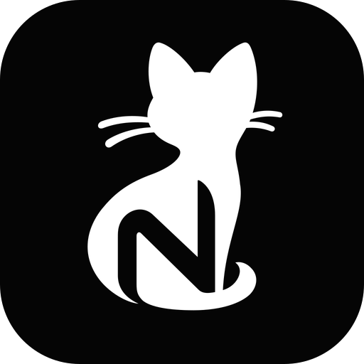
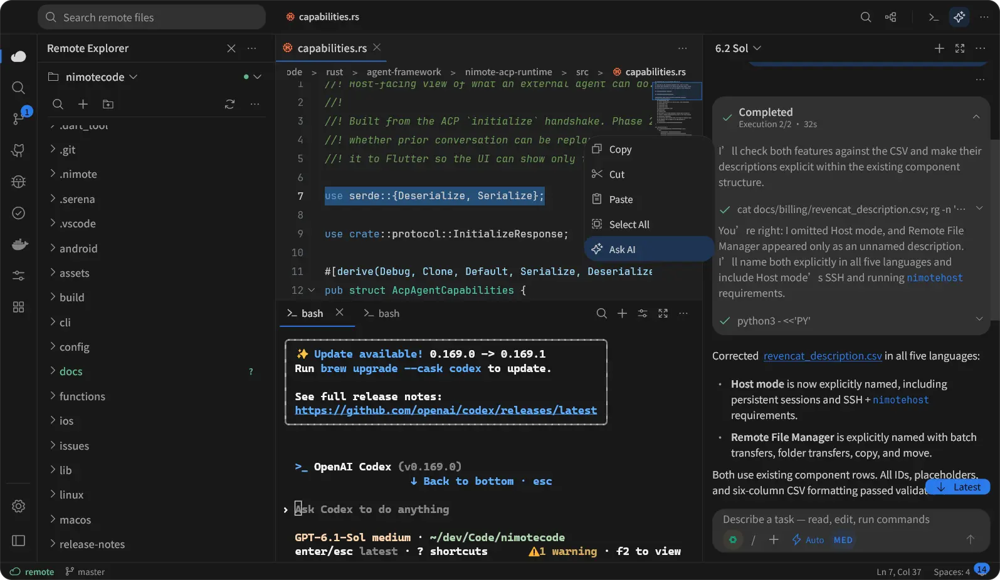
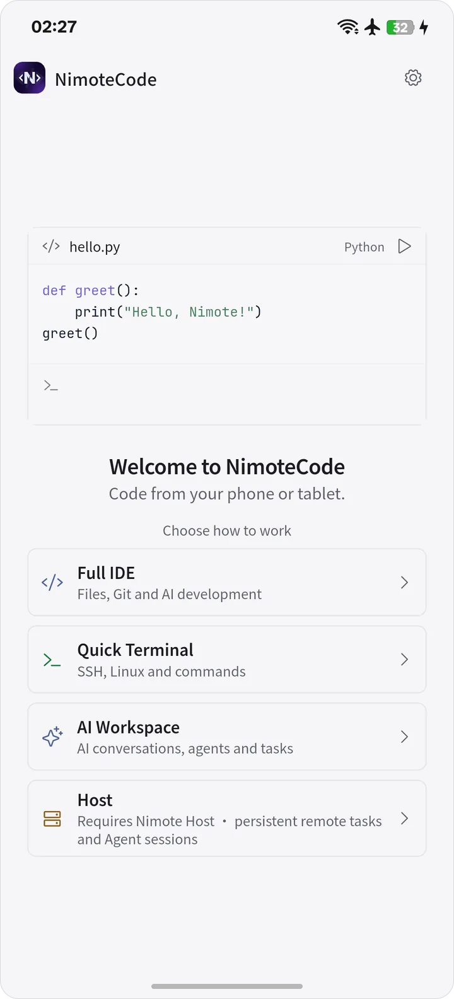
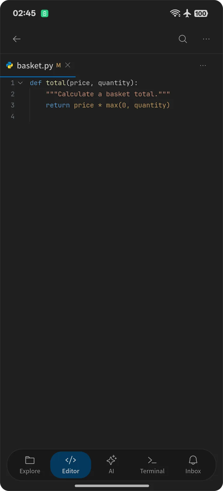
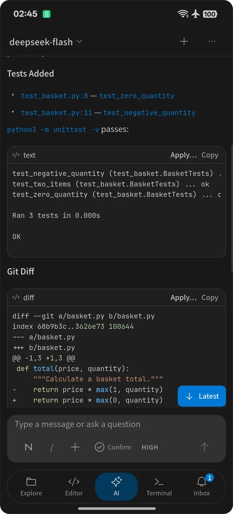
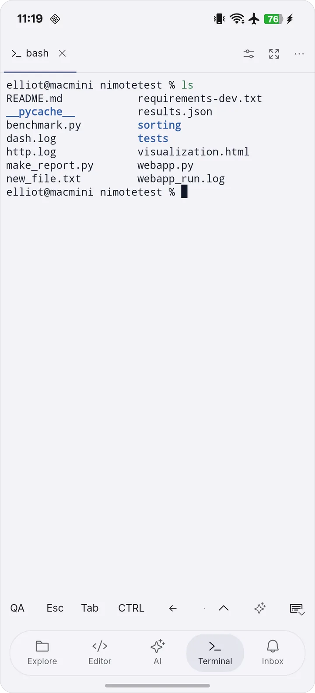
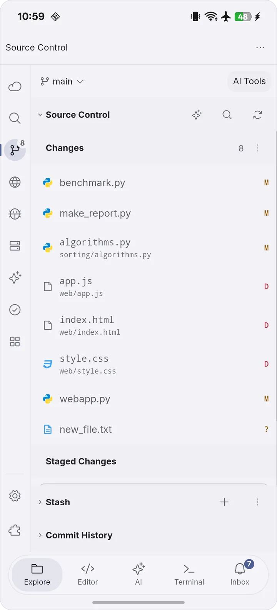

<p align="center">
  
</p>

<h1 align="center">NimoteCode — モバイル AI IDE・SSH ワークスペース</h1>

<p align="center"><a href="README.md">English</a> · <a href="README.zh-CN.md">简体中文</a> · <a href="README.es.md">Español</a> · <strong>日本語</strong> · <a href="README.ko.md">한국어</a></p>

<p align="center">
  <strong>自分のプロジェクトとツールを、どこでも。</strong><br>
  Android・iPhone・iPad で、編集、SSH ターミナル、Git、AI Agent を一つに。
</p>

<p align="center">
  <a href="https://play.google.com/store/apps/details?id=com.nimote.nimotecode"></a>
  <a href="https://apps.apple.com/app/nimotecode-ssh-client-ide/id6776158253"></a>
</p>

<p align="center">
  <a href="https://nimotecode.com/ja/releases/2.4.1"></a>
  <a href="https://nimotecode.com/ja/docs"></a>
  <a href="https://github.com/mobiledevloperlab/nimotehost"></a>
</p>

<p align="center">
  <a href="#workspace-demo">デモ</a> ·
  <a href="#workflow">作業の流れ</a> ·
  <a href="#workspace-modes">4 つのモード</a> ·
  <a href="#quick-start">クイックスタート</a> ·
  <a href="#latest-release">2.4.1 の新機能</a> ·
  <a href="#nimotehost">NimoteHost</a> ·
  <a href="https://nimotecode.com/ja/docs">ドキュメント</a> ·
  <a href="https://github.com/mobiledevloperlab/nimote_issues/issues">不具合報告</a>
</p>

<p align="center">
  
</p>

NimoteCode は、**ローカルと SSH プロジェクトのためのモバイル IDE** です。ファイルを探し、コードを編集し、コマンドを実行して Git 差分を確認するまで、一つのワークスペースで進められます。自分の AI プロバイダーや、開発マシンにインストールした Agent にも接続できます。

**4 つのモード · 自分の開発環境 · AI は任意**

<a id="workspace-demo"></a>

## デモ

ワークスペースの操作を動画で確認できます。[動画を直接開く](https://github.com/user-attachments/assets/df7de976-e743-415d-9bd1-df396a647e10)。

<div align="center">
  <video src="https://github.com/user-attachments/assets/df7de976-e743-415d-9bd1-df396a647e10" controls muted playsinline width="420"></video>
</div>

## NimoteCode を選ぶ理由

| やりたいこと | つながる作業環境 |
| --- | --- |
| **スマートフォンで作業を続ける** | SSH/SFTP のファイル、エディター、ホストのツールを使うターミナル。 |
| **タブレットで開発する** | ファイルツリー、検索、分割エディター、Markdown と Web のプレビュー。 |
| **変更を検証する** | コマンドとプロジェクトタスクのそばで Git 状態、履歴、差分を確認。 |
| **AI と協働する** | Chat、内蔵 Agent、MCP ツール、対応する外部 ACP Agent。 |
| **リモート作業に戻る** | 切断後も自分のパソコンで続く NimoteHost 管理セッション。 |
| **Android 本体で開発する** | root 不要の PRoot ベース Ubuntu、Bash、Git、SSH。 |

<a id="workspace-modes"></a>

## 一つのコマンドからプロジェクトまで、4 つのモード

ファイル、コマンド、変更、Agent の作業に、それぞれ専用のビューを用意しています。

<table>
  <tr>
    <td rowspan="5" width="180" align="center" valign="middle"><a href="docs/public/images/placeholders/host-mode.png"></a></td>
    <th>モード</th>
    <th>適した作業</th>
    <th>使える環境</th>
  </tr>
  <tr>
    <td valign="top"><strong>IDE</strong></td>
    <td valign="top">プロジェクトの理解、編集、レビュー。</td>
    <td valign="top">ファイルツリー、検索、分割エディター、ターミナル、Git を一つの画面に。</td>
  </tr>
  <tr>
    <td valign="top"><strong>AI</strong></td>
    <td valign="top">質問、タスクの依頼、実行の確認。</td>
    <td valign="top">プロジェクトの文脈、Chat・Agent、ツール出力、承認、結果。</td>
  </tr>
  <tr>
    <td valign="top"><strong>Terminal</strong></td>
    <td valign="top">ビルド、シェル操作、対話型 CLI。</td>
    <td valign="top">ターミナル中心の表示、拡張キー、履歴検索、ホストの既存ツール。</td>
  </tr>
  <tr>
    <td valign="top"><strong>Host</strong></td>
    <td valign="top">パソコンで続く作業への復帰。</td>
    <td valign="top">NimoteHost 管理のターミナル、対応 Agent、タスク、検証記録。</td>
  </tr>
</table>

**IDE・Terminal・AI の切り替えでは、プロジェクトとファイルツリーの状態を維持します。Host は NimoteHost 管理セッションに接続します。** IDE で調査し、Terminal でテストし、AI に変更を依頼して、Host でリモートタスクに戻れます。

SSH 接続から編集、Git レビュー、Agent 実行、セッション再開までをつなぐ開発環境です。SSH 上の Docker・Compose、Dev Container、言語サービス、デバッグ、カスタムプラグインで拡張できます。

[機能一覧](https://nimotecode.com/ja/features) · [モバイル開発ツールの比較](https://nimotecode.com/ja/compare/mobile-ai-development-tools)

<a id="workflow"></a>

## 一つのプロジェクトを、コードからレビューまで

SSH プロジェクトを開き、コードを確認し、Agent と協働して、ホストでコマンドを実行し、変更をレビューする。モバイルでも一連の開発作業を進められます。

<table>
  <tr>
    <th width="25%" align="center">1 · コードを確認</th>
    <th width="25%" align="center">2 · Agent と協働</th>
    <th width="25%" align="center">3 · コマンドを実行</th>
    <th width="25%" align="center">4 · 変更をレビュー</th>
  </tr>
  <tr>
    <td width="25%" align="center" valign="top"><a href="docs/public/images/placeholders/editor-code-selection.png"></a></td>
    <td width="25%" align="center" valign="top"><a href="docs/public/images/placeholders/ai-plan-running.jpg"></a></td>
    <td width="25%" align="center" valign="top"><a href="docs/public/images/placeholders/terminal-command-output.png"></a></td>
    <td width="25%" align="center" valign="top"><a href="docs/public/images/placeholders/source-control-changes.png"></a></td>
  </tr>
  <tr>
    <td valign="top">構文ハイライトと行番号でプロジェクトのファイルを読み、編集します。</td>
    <td valign="top">実行タイムラインで計画、ファイルの読み取り、ツールの動作を確認します。</td>
    <td valign="top">ホストのシェルと導入済みツールでプロジェクトのチェックを実行します。</td>
    <td valign="top">Source Control で変更ファイルを確認し、コミット前に差分を開きます。</td>
  </tr>
</table>

<sub>実際のアプリ画面です。クリックすると原寸で表示します。</sub>

途中で離れる場合も、[Host モード](#nimotehost)からパソコンの NimoteHost 管理の対応セッションに戻れます。

<a id="quick-start"></a>

## 小さな変更から始める

1. **インストール：** [Google Play](https://play.google.com/store/apps/details?id=com.nimote.nimotecode) または [App Store](https://apps.apple.com/app/nimotecode-ssh-client-ide/id6776158253) から入手します。
2. **プロジェクトを開く：** ローカルフォルダー、設定済み SSH ホスト、または Demo を選択します。AI 設定は不要です。
3. **編集 → 実行 → 確認：** ファイルを変更し、環境で使えるチェックを実行して、Git リポジトリで差分を確認します。

[クイックスタート →](https://nimotecode.com/ja/docs/quick-start)

### コードを実行する場所

| ワークスペース | ファイルとツール | 必要なもの |
| --- | --- | --- |
| **ローカル** | 端末上で閲覧・編集。 | 開けるフォルダー。システムが許可した外部フォルダーにはツールの制約があります。 |
| **SSH** | Linux・macOS・Windows ホスト上。 | 接続可能な SSH サーバー、プロジェクト、開発ツール。 |
| **Android Local Linux** | Android 上の Ubuntu。アプリ内プロジェクトを `/mnt/local` で共有。 | 対応する Android 8 以降の ARM64 / x86_64 端末。 |
| **Host** | 自分のパソコン上で NimoteHost が管理。 | SSH と稼働中の対応 NimoteHost。 |

Local Linux は iPhone・iPad では利用できません。開発コマンドは SSH ホストで実行できます。Git、LSP、デバッグ、Tasks、ファイル監視、Agent はネイティブファイルパスが必要です。利用できる機能は環境、インストール済みツール、アプリの利用権限によって異なります。

<a id="latest-release"></a>

## NimoteCode 2.4.1 公開済み

- **新しいインターフェース：** タブレット・横向きレイアウト、エディター操作、モバイル Git レビューを改善。
- **Host ワークスペース：** 対応ターミナルと Agent を再開し、承認、タスク結果、差分を確認。
- **ファイル転送：** 端末と SSH 間でファイル・フォルダーを転送し、ローカルでインポート・エクスポート。
- **プロジェクトタスク：** npm、Taskfile、Makefile、justfile、VS Code の対応タスク定義を検出。
- **ターミナルとリモート操作：** 保持された履歴の検索、選択とクリップボード、CI ステップログ、リモート保存を改善。

[2.4.1 のリリースノート](https://nimotecode.com/ja/releases/2.4.1) · [公式ダウンロード](https://nimotecode.com/ja/download)

ストアでの提供状況と配信時期はプラットフォームや地域によって異なる場合があります。

<a id="nimotehost"></a>

## NimoteHost：アプリを離れても、作業に戻れる

Linux・macOS・Windows 向けの任意のセルフホスト型サービスです。スマートフォンを切断した後もパソコンでセッションを管理し、SSH 経由でターミナルや対応する **Codex・Claude Code・OpenCode** の会話に戻れます。

Host の機能に応じて、ツール出力、承認、タスク、検証結果を確認できます。CLI またはデスクトップ管理アプリを選ぶほか、完全な **Apache-2.0 ソース**からビルド・拡張できます。

パソコンの OS と CPU に合う対応パッケージを起動し、NimoteCode 2.4.1 以降の **Host → SSH connections** から接続します。Host や OS の再起動はプロセスを中断します。Agent の導入と認証は別途必要です。通常の SSH ワークスペースは Host なしで利用できます。

[導入ガイド](https://nimotecode.com/ja/docs/host/getting-started) · [ソース](https://github.com/mobiledevloperlab/nimotehost) · [Host ダウンロード](https://github.com/mobiledevloperlab/nimotehost/releases)

## 自分のツールとプロバイダーで AI を使う

| 選択肢 | 用途 |
| --- | --- |
| **AI Chat** | コードとターミナル出力を文脈とともに説明。 |
| **内蔵 Agent** | 対応ワークスペースで調査、計画、編集、チェックを実行。 |
| **MCP** | 設定したツールを接続し、呼び出し時に承認。 |
| **ACP Agent** | 別途導入した対応ランタイムを会話画面から利用。 |
| **SSH の CLI** | ホストに導入した Claude Code、Codex などを直接実行。 |

**モデルの利用枠やプロバイダーの契約は NimoteCode と別です。** 自分の認証情報を設定し、コミット前に変更とテスト結果を確認してください。

[AI 設定](https://nimotecode.com/ja/docs/configuration) · [Agent と MCP](https://nimotecode.com/ja/docs/ai)

## ドキュメントとガイド

| 基本 | 応用 |
| --- | --- |
| [エディター](https://nimotecode.com/ja/docs/editor) | [Git・GitHub](https://nimotecode.com/ja/docs/source-control) |
| [SSH・SFTP](https://nimotecode.com/ja/docs/ssh) | [タスク](https://nimotecode.com/ja/docs/tasks) |
| [ターミナル](https://nimotecode.com/ja/docs/terminal) | [Docker](https://nimotecode.com/ja/docs/docker) |
| [Local Linux](https://nimotecode.com/ja/docs/local-linux) | [プラグイン](https://nimotecode.com/ja/docs/plugins) |

[全ドキュメント](https://nimotecode.com/ja/docs) · [FAQ](https://nimotecode.com/ja/docs/faq) · [実践ガイド（英語）](resources/README.md) · [Linux プリセット](presets/README.md)

## コミュニティと貢献

[不具合・機能要望](https://github.com/mobiledevloperlab/nimote_issues/issues) · [Discord](https://discord.gg/tTxbpqYmhR) · [X](https://x.com/mobiledevlab) · [公式サイト](https://nimotecode.com/ja/)

報告にはアプリ版、端末と OS、ワークスペース種別、再現手順、認証情報を除いたログを添えてください。文書修正、翻訳、例の追加は Pull Request で歓迎します。Host のコード貢献は [NimoteHost](https://github.com/mobiledevloperlab/nimotehost) へ。Star は他の開発者が NimoteCode を見つける助けになります。

## このリポジトリについて

**NimoteCode は商用クローズドソースアプリです。** このリポジトリは公式サイト、文書、ガイド、リリースノートを提供し、アプリのソースは含みません。

[NimoteHost](https://github.com/mobiledevloperlab/nimotehost) は Apache-2.0、[Linux Presets](https://github.com/mobiledevloperlab/nimote-linux-presets/blob/master/LICENSE) は MIT です。[Local Linux のソースとライセンス](https://nimotecode.com/ja/docs/local-linux-source)はサードパーティー部品に適用されます。各ライセンスは対応する部品のものであり、アプリや本リポジトリ全体には適用されません。

<details>
<summary>サイトとドキュメントの保守</summary>

```bash
nvm install
nvm use
npm ci
npm ci --prefix blog
node scripts/generate-readme-screenshot.mjs
npm run docs:build
npm run docs:check
```

Node 24 (`.nvmrc`); `npm run docs:dev`.

</details>

---

## NimoteCode を一緒に使いやすく

NimoteCode が役に立ったら、[⭐ Star](https://github.com/mobiledevloperlab/nimotecode) で他の開発者にも広めていただけるとうれしいです。

改善案、機能のリクエスト、不具合は、アプリ内のフィードバックまたは [GitHub Issues](https://github.com/mobiledevloperlab/nimote_issues/issues) へ。実際に使った感想が、今後の改善につながります。
