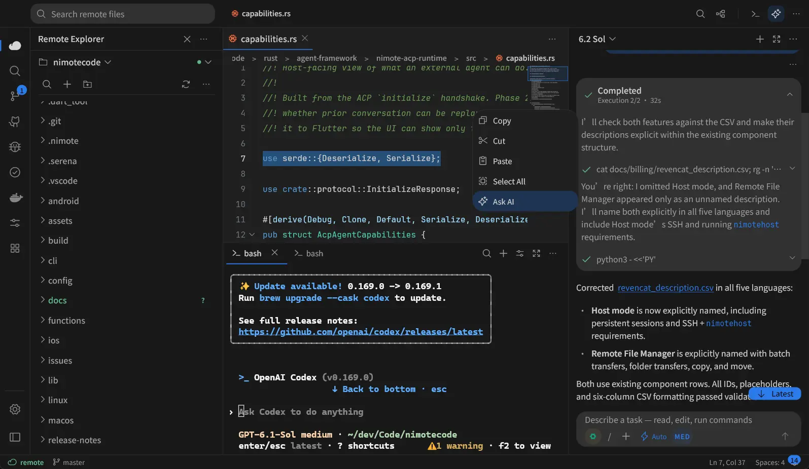

<p align="center"></p>

<h1 align="center">NimoteCode — Android / iOS용 모바일 IDE</h1>

<p align="center"><a href="README.md">English</a> · <a href="README.zh-CN.md">简体中文</a> · <a href="README.es.md">Español</a> · <a href="README.ja.md">日本語</a> · 한국어</p>

<p align="center"><strong>휴대폰이나 태블릿에서 프로젝트를 계속 진행하세요.</strong><br>로컬 프로젝트를 열거나 SSH로 개발 호스트에 연결하세요. 하나의 모바일 작업 공간에서 코드를 편집하고, 명령을 실행하고, Git 변경 사항을 검토하고, AI와 함께 작업할 수 있습니다.</p>

<p align="center"><sub>코드 편집기&nbsp;&nbsp;•&nbsp;&nbsp;SSH 터미널&nbsp;&nbsp;•&nbsp;&nbsp;Git&nbsp;&nbsp;•&nbsp;&nbsp;AI 코딩<br>지원되는 Android 기기에서 root 없이 Ubuntu 사용</sub></p>

<p align="center"><a href="https://play.google.com/store/apps/details?id=com.nimote.nimotecode"></a> <a href="https://apps.apple.com/app/nimotecode-ssh-client-ide/id6776158253"></a></p>

<p align="center"><sub><a href="#workspace-demo">데모</a> · <a href="#nimotehost">NimoteHost</a> · <a href="https://nimotecode.com/ko/docs/quick-start">빠른 시작</a> · <a href="https://nimotecode.com/ko/releases/2.4.1">릴리스 노트</a></sub></p>

<p align="center"><sub>무료로 시작할 수 있으며 AI 설정은 선택 사항입니다. 상용 비공개 소스 앱 · NimoteHost는 Apache-2.0 공개 예정</sub></p>

<p align="center"></p>

<a id="workspace-demo"></a>

## 데모

위 이미지는 휴대폰의 AI Agent와 태블릿의 SSH 작업 공간을 보여 줍니다. [데모 동영상 열기](https://github.com/user-attachments/assets/df7de976-e743-415d-9bd1-df396a647e10).

<div align="center">
  <video src="https://github.com/user-attachments/assets/df7de976-e743-415d-9bd1-df396a647e10" controls muted playsinline width="420"></video>
</div>

## 프로젝트가 있는 곳에서 개발하세요

- **로컬 프로젝트:** 시스템 선택기로 폴더를 열고 바로 편집을 시작하세요.
- **SSH 개발 호스트:** 원격 파일, 터미널, Git 변경 사항을 하나의 작업 공간에서 다룹니다.
- **Android 로컬 Linux:** 지원되는 Android에서 PRoot Ubuntu, Bash, Git, SSH를 사용하고 로컬 프로젝트를 `/mnt/local`에서 공유합니다.

Local Linux는 지원되는 Android 8 이상 ARM64 / x86_64 기기가 필요하며 iPhone과 iPad에서는 사용할 수 없습니다. SSH 호스트는 설정되어 있고 연결 가능해야 합니다.

## 핵심 기능

- **원격 작업 지속:** 선택형 [NimoteHost](https://nimotecode.com/ko/docs/host)로 터미널, 작업과 호환 Agent를 관리하고 연결 해제 후 돌아옵니다. 2.4.1 제공 예정입니다.
- **작업 공간 전환:** 프로젝트와 탐색기 상태를 유지하며 IDE, 터미널, AI 모드를 전환합니다.
- **컨테이너 개발:** SSH 호스트에서 Docker와 Compose를 관리하고 `devcontainer.json`으로 Dev Container를 만들거나 다시 빌드합니다.
- **편집 및 탐색:** 휴대폰, 태블릿, 데스크톱에서 Nimote Editor를 사용하고, 파일 검색, 분할 편집기, Markdown 및 웹 미리 보기를 이용하세요.
- **실행 및 검증:** 터미널, 프로젝트 작업, 모바일 추가 키, 집중 모드, 색상표 및 SOCKS5 / HTTP CONNECT SSH 프록시를 사용하세요.
- **Git 검토:** 상태, diff, 기록을 검토하고 Git 헤더에서 브랜치를 검색, 생성, 전환하세요.
- **작업 공간 확장:** Early Access 플러그인 센터에서 맞춤 패널, 양식, 워크플로, 결과 보기, 로컬 또는 SSH 스크립트 작업을 만드세요.

- **언어 도구:** 지원되는 언어 서버로 편집기 진단을 보고 구성된 원격 디버그 어댑터로 디버깅할 수 있습니다. LSP와 디버깅은 Early Access 워크플로이며 적절한 환경 도구가 필요합니다.
- **외부 폴더:** 시스템에서 권한을 부여한 외부 폴더는 탐색과 편집을 지원하지만 Git, LSP, 디버깅, Tasks, 파일 감시 및 Agent에는 네이티브 파일 시스템 경로가 필요합니다.
- **가용성:** 도구는 작업 공간, 설치된 도구 및 플랜에 따라 달라집니다. [기능 참조](https://nimotecode.com/ko/features?utm_source=github&utm_medium=referral&utm_campaign=readme&utm_content=ko_features)를 확인하세요.


<a id="nimotehost"></a>

## NimoteHost: 내 컴퓨터에서 작업 계속하기

**NimoteHost**는 Linux, macOS, Windows에 직접 설치하는 선택형 보조 서비스로 CLI와 데스크톱 관리자를 제공합니다. 휴대폰에서 작업을 시작하고 연결을 끊은 뒤 SSH로 돌아와 계속 실행 중인 터미널, 로그와 호환 Agent 대화를 확인하세요.

- 호환 Codex, Claude Code, OpenCode의 구조화된 도구 출력과 승인을 확인하고 지원되는 경우 실행 중 지시를 추가합니다.
- 세션 검색과 고정, 작업 수신함, 검증 기록과 diff 확인, 지원되는 Host의 GitHub Issue 작업 전달을 사용합니다.
- CLI/GUI 패키지 배포, 소스 빌드, RPC, Go 클라이언트, MCP와 커뮤니티 플러그인 연동을 지원합니다.

Host 모드는 **2.4.1 출시 예정 기능**입니다. NimoteHost는 [별도 저장소](https://github.com/mobiledevloperlab/nimotehost)에서 **Apache-2.0** 오픈 소스로 공개할 예정이며 NimoteCode 앱은 상용 비공개 소스로 유지됩니다. GitHub가 404를 표시하거나 패키지가 없으면 아직 공개 다운로드가 제공되지 않은 상태입니다.

컴퓨터에 전체 패키지를 설치하고 `status`와 `capabilities`를 확인한 뒤 앱의 **Host → SSH connections**에서 같은 OS 계정으로 연결하세요. 일반 SSH에는 Host가 필요 없습니다. Host와 컴퓨터는 계속 실행되어야 하며 Host/OS 재시작은 프로세스를 중단합니다. Agent 설치, 인증과 모델 비용은 별도이며 기능은 양쪽 버전에 따라 다릅니다.

[**설치, 배포 및 사용 안내 →**](https://nimotecode.com/ko/docs/host) · [소스 및 라이선스](https://github.com/mobiledevloperlab/nimotehost) · [다운로드](https://github.com/mobiledevloperlab/nimotehost/releases)

## 원하는 방식의 AI 코딩

| 워크플로 | 사용 방법 |
| --- | --- |
| **AI Chat** | 작업 공간 문맥으로 코드와 터미널 출력을 설명합니다. 자신의 AI 공급자와 API 키를 연결하세요. |
| **내장 Agent** | 파일을 검사하고, 변경을 계획하고, 편집 및 검사를 실행합니다. 실행 중인 Agent에 후속 지시를 추가하고 대화형 질문에 답할 수 있습니다. Early Access에서 제공됩니다. |
| **MCP 도구 서버** | 로컬 또는 SSH 작업 공간에서 내장 Agent용 검증된 MCP 서버를 구성합니다. 모든 도구 호출에는 명시적 승인이 필요합니다. |
| **외부 ACP Agent** | SSH 호스트의 호환 런타임을 연결하고 앱 대화 화면에서 권한과 진행 상황을 검토합니다. |
| **SSH의 Claude Code / Codex** | 자신의 호스트에 설치한 CLI를 터미널에서 실행합니다. |

모델 액세스와 토큰은 포함되지 않습니다. 외부 Agent와 CLI는 별도 설치, 인증 및 서비스 액세스가 필요합니다. Claude Code와 Codex는 포함되지 않습니다. AI가 생성한 변경 사항을 수락하기 전에 명령과 diff를 검토하세요.

## 시작하기

1. [Google Play](https://play.google.com/store/apps/details?id=com.nimote.nimotecode) 또는 [App Store](https://apps.apple.com/app/nimotecode-ssh-client-ide/id6776158253)에서 NimoteCode를 설치하세요.
2. 로컬 프로젝트를 열고, SSH 호스트에 연결하거나, Demo 작업 공간을 살펴보세요.
3. 작은 변경을 수행하고 사용 가능한 검사를 실행한 뒤 Git diff를 검토하세요.

> [빠른 시작 →](https://nimotecode.com/ko/docs/quick-start?utm_source=github&utm_medium=referral&utm_campaign=readme&utm_content=ko_quick_start)

**무료로 시작하고 Early Access에서 고급 워크플로를 사용하세요:** 무료에는 로컬 및 SSH 작업 공간, 편집기, 기본 터미널, Git 검토, AI Chat 및 기본 Tasks가 포함됩니다. GitHub 연동, Android Local Linux, AI Agent, 원격 콘텐츠 검색, 다중 터미널, Git 쓰기, LSP 및 디버깅은 Early Access로 제공됩니다. 현재 제공 여부와 조건은 [Early Access 세부 정보](https://nimotecode.com/ko/pro?utm_source=github&utm_medium=referral&utm_campaign=readme&utm_content=ko_plans) 및 앱에서 확인하세요.

스토어 제공 여부와 출시 시점은 플랫폼과 지역에 따라 다를 수 있습니다. [다운로드 및 플랫폼 요구 사항](https://nimotecode.com/ko/download?utm_source=github&utm_medium=referral&utm_campaign=readme&utm_content=ko_download)을 확인하세요.

## 다운로드

Android용은 [Google Play](https://play.google.com/store/apps/details?id=com.nimote.nimotecode), iPhone 및 iPad용은 [App Store](https://apps.apple.com/app/nimotecode-ssh-client-ide/id6776158253)에서 다운로드하세요.

[Host 모드: NimoteHost 설치, SSH 연결, 터미널 및 Agent 사용법.](https://nimotecode.com/ko/docs/host)

**NimoteCode 2.4.1 출시 예정:** 공개되지 않은 2.4.0 기능을 포함합니다. Windows, macOS, Linux용 NimoteCode와 NimoteHost도 곧 출시됩니다.

## NimoteCode 2.4.1 · 출시 예정

- **작업 흐름 개선.** 보관된 터미널 기록 검색과 탐색기 Git 상태 색상을 지원하며, 터미널 선택, 가로 화면, 원격 저장, Windows 다중 프로세스 안정성을 개선했습니다. 네이티브 Host Agent 세션 연결은 실험 기능이며 명시적인 빌드 설정과 호환 Host가 필요합니다.

- **Host 작업 공간.** 원격 컴퓨터에 호환 NimoteHost를 설치하고 시작한 뒤 SSH로 연결해 터미널 및 Agent 세션을 검색, 고정하고 다시 시작합니다. Host는 선택 기능입니다.
- **Agent 협업.** 호환 Codex, Claude, OpenCode 세션에서 구조화된 대화, 도구, 승인, 명령, 모델 설정과 실행 중 추가 지시를 지원합니다. 실행 정책은 Host에 따라 다르며 민감한 작업은 승인이 필요할 수 있습니다.
- **작업 수신함과 GitHub Issue.** 상태, 검증 증거와 diff를 확인하고 작업을 계속하거나 보관합니다. 선택한 게시 정책으로 Issue를 전달합니다. Host 버전 및 설정에 따라 다릅니다.
- **Host 플러그인.** 사이드바에서 버전이 지정된 양식, 페이지별 표, 상세 및 대화형 보기를 권한 확인과 함께 사용합니다.
- **프로젝트 작업.** package.json, Taskfile, Makefile, justfile 및 .vscode/tasks.json에서 지원되는 작업을 찾아 터미널에서 실행합니다. Make/just 동적 탐색은 명시적 확인이 필요합니다.
- **알림 및 편집기.** 완료, 확인 대기 및 실패 알림, 소리와 진동, 줄 번호와 가로 미니맵을 설정합니다. 알림은 시스템 설정을 따릅니다. Windows에서는 Pro가 기본 활성화됩니다.
- 기능, 패널 및 플러그인 설정을 통합하고 알림을 Agent 설정으로 이동했습니다. 태블릿, Windows, 가로 색상 및 동작 줄이기를 개선했습니다.
- 브랜치와 워크플로별 GitHub CI 필터, 단계 로그, 오류 문맥과 불완전한 로그 안내를 제공합니다.
- 터미널 응답성, 동기화 업데이트, 검색, 스크롤, Vim, 클립보드, Windows 붙여넣기 및 소프트 키보드를 개선했습니다.
- 기록 안정성, 로컬 기록 오프라인 삭제, 원격 저장 오류 안내, 큰 파일 편집, 줄바꿈 diff 및 하단 탐색을 개선했습니다.

[2.4.1 →](https://nimotecode.com/ko/releases/2.4.1)

## 문서

- [빠른 시작](https://nimotecode.com/ko/docs/quick-start) · [SSH](https://nimotecode.com/ko/docs/ssh) · [터미널](https://nimotecode.com/ko/docs/terminal) · [편집기](https://nimotecode.com/ko/docs/editor)
- [AI Chat & Agent](https://nimotecode.com/ko/docs/ai) · [소스 제어](https://nimotecode.com/ko/docs/source-control) · [LSP](https://nimotecode.com/ko/docs/lsp) · [디버깅](https://nimotecode.com/ko/docs/debug)
- [Docker](https://nimotecode.com/ko/docs/docker) · [Plugins](https://nimotecode.com/ko/docs/plugins) · [보안](https://nimotecode.com/ko/docs/security) · [전체 문서](https://nimotecode.com/ko/docs)

### 가이드와 자료

- [공식 웹사이트](https://nimotecode.com/ko/?utm_source=github&utm_medium=referral&utm_campaign=readme&utm_content=ko_website)
- [기능](https://nimotecode.com/ko/features?utm_source=github&utm_medium=referral&utm_campaign=readme&utm_content=ko_features)
- [모바일 개발 가이드](resources/README.md) — 로컬 편집, 원격 개발, Git 및 AI 워크플로(영어).
- [Linux 프리셋](https://github.com/mobiledevloperlab/nimote-linux-presets) — 버전이 지정된 매니페스트와 검증 스크립트를 포함하는 선택적 환경.

## 자주 묻는 질문

**Termux, Acode, code-server와 어떻게 다른가요?** NimoteCode는 터치에 맞춘 편집기, SSH 클라이언트, 터미널, Git, AI를 하나의 모바일 앱에 결합하며 Android에서 선택적으로 Local Linux를 제공합니다. Termux는 Android 터미널과 패키지, Acode는 모바일 코드 편집, code-server는 브라우저에서 실행하는 VS Code에 중점을 둡니다.

**SSH 서버가 필요한가요?** 아니요. 로컬 폴더나 Demo 작업 공간으로 시작할 수 있습니다. SSH 작업 공간에는 설정되어 있고 연결 가능한 호스트가 필요합니다.

**휴대폰에서 코드를 실행할 수 있나요?** 지원되는 Android 기기에서는 Local Linux를 사용할 수 있습니다. iPhone과 iPad에서는 SSH로 적절한 원격 호스트를 사용할 수 있습니다. 실행 가능 여부는 설치된 도구에 따라 다릅니다.

**AI가 포함되어 있나요?** AI 설정은 선택 사항입니다. 직접 공급자와 API 키를 준비해야 하며 모델 사용료가 별도로 발생할 수 있습니다. 내장 Agent는 Early Access 기능입니다.

**오픈 소스인가요?** 앱은 상용 비공개 소스입니다. 이 리포지토리는 문서와 자료를 제공합니다. 별도 [NimoteHost](https://github.com/mobiledevloperlab/nimotehost)는 Apache-2.0으로 공개 예정이며 해당 라이선스는 Host에 적용됩니다.

[FAQ 더 보기](https://nimotecode.com/ko/docs/faq).

## 모바일 개발 도구 비교

**편집 → 검사 실행 → diff 검토 → 작업 공간 확장을 하나의 모바일 IDE에서.** NimoteCode 열은 미출시 2.4.0 빌드(2.4.1에 포함 예정)를 반영합니다. `?`는 해당 제품의 기능이 확인되지 않았음을 뜻합니다.

| 주요 기능 | **NimoteCode** | Termius | Blink Shell | ServerCC |
| --- | :---: | :---: | :---: | :---: |
| SSH 연결 | ✅ | ✅ | ✅ | ✅ |
| 코드 편집기 | ✅ | ? | ✅ | ? |
| 맞춤 플러그인 / 패널 | ✅ ¹ | ? | ? | ? |
| Git / diff UI | ✅ ¹ | ? | ◐ | ✅ |
| Git 브랜치 작업 | ✅ ¹ | ? | ? | ? |
| 내장 AI Agent | ✅ ¹ | ? | ? | ? |
| 실행 중인 AI Agent 계속 진행 | ✅ ¹ | ? | ? | ? |
| 내장 MCP 도구 서버 | ✅ ¹ | ? | ? | ? |
| LSP 진단 | ✅ ¹ | ? | ◐ | ? |
| 웹 / 앱 미리 보기 | ✅ | ? | ? | ✅ |
| SOCKS5 / HTTP CONNECT SSH 프록시 | ✅ | ? | ? | ? |
| Android 로컬 Linux | ✅ ² | ? | ? | ? |
| Mosh 전송 | ? | ✅ | ✅ | ? |

<details><summary>Redock, Orca, Moshi와 비교</summary>

| 주요 기능 | **NimoteCode** | Redock | Orca | Moshi |
| --- | :---: | :---: | :---: | :---: |
| SSH 연결 | ✅ | ✅ | ◐ | ✅ |
| 코드 편집기 | ✅ | ? | — | ? |
| 맞춤 플러그인 / 패널 | ✅ ¹ | ? | ? | ? |
| Git / diff UI | ✅ ¹ | ? | ✅ | ✅ |
| Git 브랜치 작업 | ✅ ¹ | ? | ? | ? |
| 내장 AI Agent | ✅ ¹ | ? | ? | ? |
| 실행 중인 AI Agent 계속 진행 | ✅ ¹ | ? | ? | ? |
| 내장 MCP 도구 서버 | ✅ ¹ | ? | ? | ? |
| LSP 진단 | ✅ ¹ | ? | ? | ? |
| 웹 / 앱 미리 보기 | ✅ | ✅ | ✅ | ✅ |
| SOCKS5 / HTTP CONNECT SSH 프록시 | ✅ | ? | ? | ? |
| Android 로컬 Linux | ✅ ² | ? | ? | ? |
| Mosh 전송 | ? | ✅ | ? | ✅ |

Orca 모바일에는 데스크톱 Companion이 필요합니다. Moshi의 diff와 웹 미리 보기에는 Pro 및 호스트 hook이 필요합니다. Redock의 미리 보기는 호스트 개발 서버를 사용합니다.

</details>

¹ 플러그인 센터, Agent(실행 중 후속 지시 및 구성된 MCP 도구 서버 포함), Git 쓰기 및 LSP는 Early Access 대상이며 Git 상태, diff 및 기록은 무료입니다. ² 지원되는 Android 8+ ARM64 / x86_64가 필요합니다. 내장 Agent에는 자신의 AI 공급자가, LSP에는 구성된 호스트 언어 서버가 필요합니다.

체크 표시는 무료, 설정 불필요 또는 모든 플랫폼에서 사용 가능함을 뜻하지 않습니다. Blink 편집은 Blink Code를 통해 통합되며 Git / LSP는 리포지토리나 원격 IDE 구성에 따라 달라집니다. Termius Mosh는 여기서 Android만 확인했습니다.

> [공식 근거가 포함된 전체 비교 보기 →](https://nimotecode.com/ko/compare/mobile-ai-development-tools?utm_source=github&utm_medium=referral&utm_campaign=readme&utm_content=ko_comparison)

## 기여하기

문서와 예제 개선을 위한 Pull Request를 환영합니다. 앱 문제나 기능 제안은 [이슈 트래커](https://github.com/mobiledevloperlab/nimote_issues/issues)를 이용하고, 재현 단계와 기기 및 앱 버전을 함께 알려 주세요. 앱 소스 코드는 이 리포지토리에 없습니다.

## 커뮤니티

버그를 공유하거나 질문하거나 지원되었으면 하는 워크플로를 제안하세요.

<p align="center"><a href="https://discord.gg/tTxbpqYmhR">Discord</a> · <a href="https://github.com/mobiledevloperlab/nimote_issues/issues">문제 신고</a> · <a href="https://x.com/mobiledevlab">X</a></p>

## 이 리포지토리 정보

별도 [NimoteHost](https://github.com/mobiledevloperlab/nimotehost)는 Apache-2.0으로 공개 예정이며 해당 라이선스는 Host에 적용됩니다.

NimoteCode는 상용 비공개 소스 애플리케이션입니다. 이 리포지토리에는 공식 문서, 튜토리얼, 워크플로 예제 및 릴리스 노트가 포함되며 애플리케이션 소스 코드는 공개되지 않습니다. Linux 프리셋은 별도 리포지토리에서 관리되고 버그 보고에는 위의 이슈 트래커를 사용합니다.

[Local Linux 소스 번들 및 라이선스 고지](https://nimotecode.com/ko/docs/local-linux-source)는 타사 구성 요소를 다루며 NimoteCode 애플리케이션을 오픈 소스로 만들지 않습니다.


[Linux Presets MIT 라이선스](https://github.com/mobiledevloperlab/nimote-linux-presets/blob/master/LICENSE)는 해당 리포지토리에 적용되며 앱이나 이곳의 모든 콘텐츠에는 적용되지 않습니다.

<details>
<summary>웹사이트와 문서 유지 관리</summary>

```bash
nvm install
nvm use
npm ci
npm ci --prefix blog
npm run docs:build
npm run docs:check
```

Node 24 (`.nvmrc`); `npm run docs:dev`.

</details>
