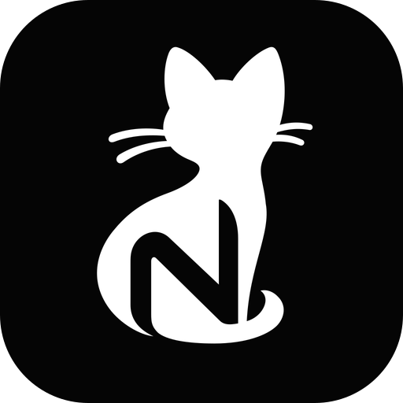
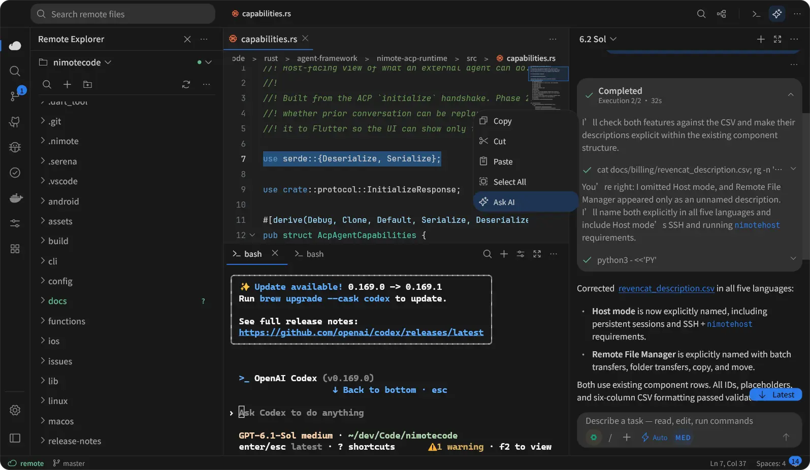
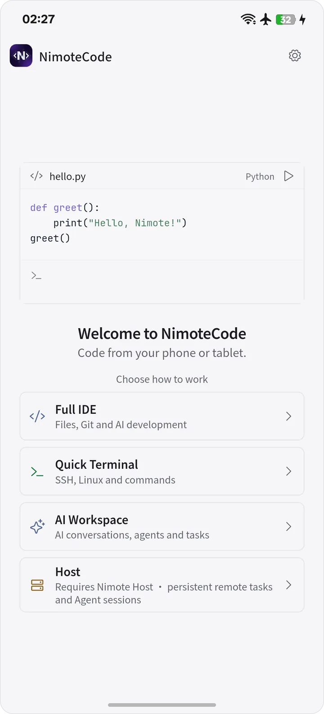
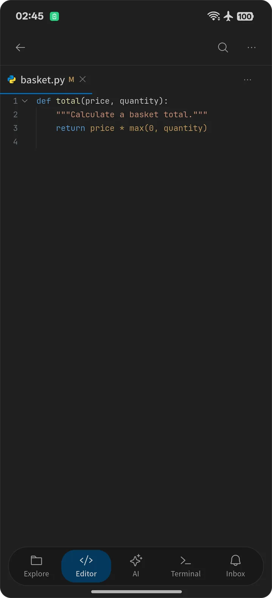
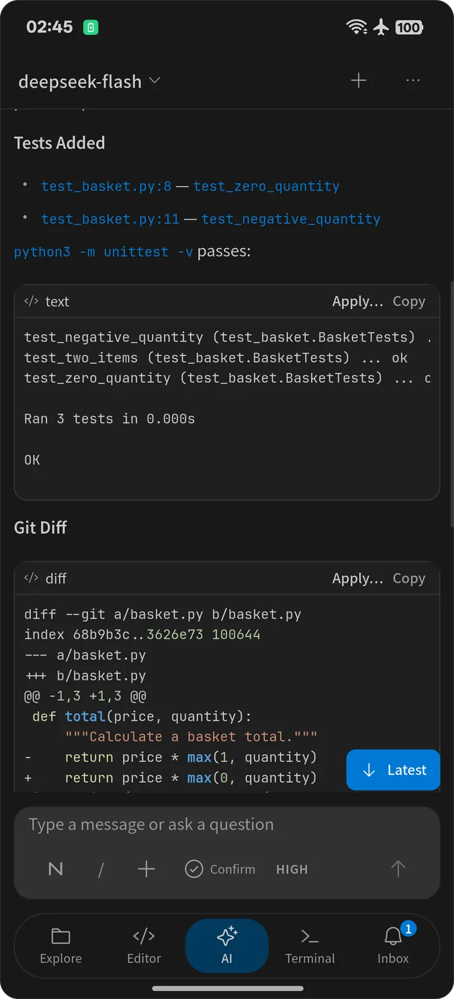
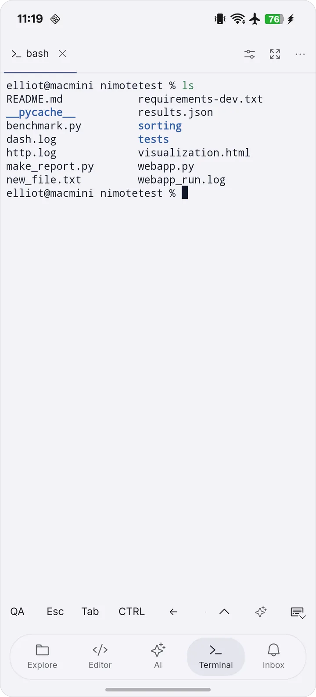
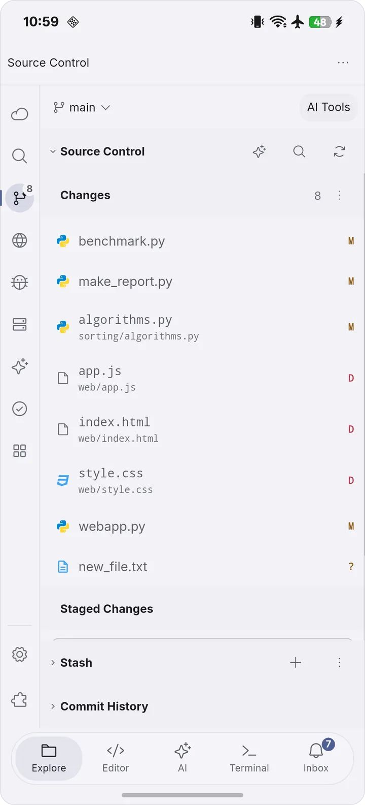

<p align="center">
  
</p>

<h1 align="center">NimoteCode — 모바일 AI IDE 및 SSH 작업 공간</h1>

<p align="center"><a href="README.md">English</a> · <a href="README.zh-CN.md">简体中文</a> · <a href="README.es.md">Español</a> · <a href="README.ja.md">日本語</a> · <strong>한국어</strong></p>

<p align="center">
  <strong>내 프로젝트와 도구를 어디서나.</strong><br>
  Android, iPhone, iPad를 위한 편집기, SSH 터미널, Git과 AI Agent.
</p>

<p align="center">
  <a href="https://play.google.com/store/apps/details?id=com.nimote.nimotecode"></a>
  <a href="https://apps.apple.com/app/nimotecode-ssh-client-ide/id6776158253"></a>
</p>

<p align="center">
  <a href="https://nimotecode.com/ko/releases/2.4.1"></a>
  <a href="https://nimotecode.com/ko/docs"></a>
  <a href="https://github.com/mobiledevloperlab/nimotehost"></a>
</p>

<p align="center">
  <a href="#workspace-demo">데모</a> ·
  <a href="#workflow">개발 흐름</a> ·
  <a href="#workspace-modes">네 가지 모드</a> ·
  <a href="#quick-start">빠른 시작</a> ·
  <a href="#latest-release">2.4.1 새 기능</a> ·
  <a href="#nimotehost">NimoteHost</a> ·
  <a href="https://nimotecode.com/ko/docs">문서</a> ·
  <a href="https://github.com/mobiledevloperlab/nimote_issues/issues">문제 보고</a>
</p>

<p align="center">
  
</p>

NimoteCode는 **로컬 및 SSH 프로젝트를 위한 모바일 IDE**입니다. 파일 탐색, 코드 편집, 프로젝트 명령 실행, Git diff 검토를 하나의 작업 공간에서 이어갑니다. 원하는 AI 제공자를 연결하거나 개발 컴퓨터에 설치한 Agent를 사용할 수 있습니다.

**네 가지 모드 · 나만의 개발 환경 · 선택형 AI**

<a id="workspace-demo"></a>

## 데모

영상에서 작업 공간을 살펴보세요. [영상 직접 열기](https://github.com/user-attachments/assets/df7de976-e743-415d-9bd1-df396a647e10)。

<div align="center">
  <video src="https://github.com/user-attachments/assets/df7de976-e743-415d-9bd1-df396a647e10" controls muted playsinline width="420"></video>
</div>

## NimoteCode를 선택하는 이유

| 하고 싶은 작업 | 연결된 개발 흐름 |
| --- | --- |
| **휴대폰에서 프로젝트 이어가기** | SSH/SFTP 파일, 코드 편집기와 호스트 도구를 사용하는 터미널. |
| **태블릿에서 개발하기** | 파일 트리, 검색, 분할 편집기, Markdown 및 웹 미리보기. |
| **변경 사항 검증하기** | 프로젝트 명령과 작업 옆에서 Git 상태, 기록과 diff 확인. |
| **AI와 협업하기** | Chat, 내장 Agent, MCP 도구와 호환 ACP Agent. |
| **원격 작업으로 돌아오기** | 연결을 끊어도 내 컴퓨터에서 유지되는 NimoteHost 관리 세션. |
| **Android에서 로컬 개발하기** | root 없이 PRoot 기반 Ubuntu, Bash, Git, SSH 사용. |

<a id="workspace-modes"></a>

## 명령 하나부터 프로젝트 전체까지, 네 가지 모드

파일, 명령, 코드 변경, Agent 작업에 맞는 전용 화면을 선택하세요.

<table>
  <tr>
    <td rowspan="5" width="180" align="center" valign="middle"><a href="docs/public/images/placeholders/host-mode.png"></a></td>
    <th>모드</th>
    <th>언제 사용하나요?</th>
    <th>작업 환경</th>
  </tr>
  <tr>
    <td valign="top"><strong>IDE</strong></td>
    <td valign="top">프로젝트 읽기, 편집, 검토.</td>
    <td valign="top">파일 트리, 검색, 분할 편집기, 터미널과 Git을 한 작업대에서 사용.</td>
  </tr>
  <tr>
    <td valign="top"><strong>AI</strong></td>
    <td valign="top">질문, 작업 위임, 실행 과정 확인.</td>
    <td valign="top">프로젝트 맥락, Chat 및 Agent, 도구 출력, 승인 요청과 결과.</td>
  </tr>
  <tr>
    <td valign="top"><strong>Terminal</strong></td>
    <td valign="top">빌드, 셸 명령, 대화형 CLI 실행.</td>
    <td valign="top">터미널 중심 화면, 확장 키, 기록 검색과 호스트의 기존 도구.</td>
  </tr>
  <tr>
    <td valign="top"><strong>Host</strong></td>
    <td valign="top">컴퓨터에서 실행 중인 작업으로 복귀.</td>
    <td valign="top">NimoteHost 관리 터미널, 호환 Agent, 작업과 검증 기록.</td>
  </tr>
</table>

**IDE, Terminal, AI를 전환해도 프로젝트와 파일 탐색기 상태가 유지됩니다. Host는 NimoteHost 관리 세션에 연결합니다.** IDE에서 문제를 살펴보고, Terminal에서 검사하고, AI에 변경을 맡긴 뒤 Host에서 원격 작업을 이어가세요.

SSH 접속부터 편집, Git 검토, Agent 실행과 세션 복구까지 이어지는 개발 흐름입니다. SSH의 Docker와 Compose, Dev Container, 언어 서비스, 디버깅과 맞춤 플러그인으로 확장할 수 있습니다.

[전체 기능](https://nimotecode.com/ko/features) · [모바일 개발 도구 비교](https://nimotecode.com/ko/compare/mobile-ai-development-tools)

<a id="workflow"></a>

## 하나의 프로젝트, 코드에서 검토까지

SSH 프로젝트를 열고, 코드를 살펴보고, Agent와 협업한 뒤 호스트에서 명령을 실행하고 변경 사항을 검토하세요. 모바일에서도 개발 흐름을 이어갈 수 있습니다.

<table>
  <tr>
    <th width="25%" align="center">1 · 코드 살펴보기</th>
    <th width="25%" align="center">2 · Agent와 협업</th>
    <th width="25%" align="center">3 · 명령 실행</th>
    <th width="25%" align="center">4 · 변경 검토</th>
  </tr>
  <tr>
    <td width="25%" align="center" valign="top"><a href="docs/public/images/placeholders/editor-code-selection.png"></a></td>
    <td width="25%" align="center" valign="top"><a href="docs/public/images/placeholders/ai-plan-running.jpg"></a></td>
    <td width="25%" align="center" valign="top"><a href="docs/public/images/placeholders/terminal-command-output.png"></a></td>
    <td width="25%" align="center" valign="top"><a href="docs/public/images/placeholders/source-control-changes.png"></a></td>
  </tr>
  <tr>
    <td valign="top">구문 강조와 줄 번호로 프로젝트 파일을 읽고 편집합니다.</td>
    <td valign="top">실행 타임라인에서 Agent의 계획, 파일 읽기와 도구 활동을 확인합니다.</td>
    <td valign="top">호스트 셸과 설치된 도구로 프로젝트 검사를 실행합니다.</td>
    <td valign="top">Source Control에서 변경 파일을 확인하고 커밋 전에 diff를 검토합니다.</td>
  </tr>
</table>

<sub>실제 앱 화면입니다. 클릭하면 원본 크기로 볼 수 있습니다.</sub>

잠시 자리를 비워야 하나요? [Host 모드](#nimotehost)에서 컴퓨터의 NimoteHost 관리 호환 세션으로 돌아올 수 있습니다.

<a id="quick-start"></a>

## 작은 변경부터 시작하세요

1. **설치:** [Google Play](https://play.google.com/store/apps/details?id=com.nimote.nimotecode) 또는 [App Store](https://apps.apple.com/app/nimotecode-ssh-client-ide/id6776158253)에서 설치합니다.
2. **프로젝트 열기:** 로컬 폴더, 설정된 SSH 호스트 또는 Demo를 선택하세요. AI 설정 없이 시작할 수 있습니다.
3. **편집 → 실행 → 검토:** 파일을 바꾸고 환경에서 지원하는 검사를 실행한 뒤 Git 저장소에서 diff를 확인하세요.

[빠른 시작 →](https://nimotecode.com/ko/docs/quick-start)

### 코드가 실행되는 위치

| 작업 공간 | 파일과 도구의 위치 | 필요한 것 |
| --- | --- | --- |
| **로컬** | 기기에서 파일 탐색 및 편집. | 열 수 있는 폴더. 시스템이 허용한 외부 폴더는 도구 사용에 제한이 있습니다. |
| **SSH** | Linux, macOS 또는 Windows 호스트. | 접근 가능한 SSH 서버, 프로젝트와 설치된 개발 도구. |
| **Android Local Linux** | Android의 Ubuntu. 앱 로컬 프로젝트를 `/mnt/local`로 공유. | 지원되는 Android 8+ ARM64 / x86_64 기기. |
| **Host** | NimoteHost가 관리하는 내 컴퓨터. | SSH와 실행 중인 호환 NimoteHost. |

iPhone과 iPad에서는 Local Linux를 사용할 수 없으며 SSH 호스트에서 개발 명령을 실행할 수 있습니다. Git, LSP, 디버깅, Tasks, 파일 감시와 Agent에는 네이티브 파일 경로가 필요합니다. 기능은 환경, 설치된 도구와 앱 이용 권한에 따라 달라집니다.

<a id="latest-release"></a>

## NimoteCode 2.4.1 출시

- **새 인터페이스:** 태블릿과 가로 화면, 편집기 조작, 모바일 Git 검토 개선.
- **Host 작업 공간:** 호환 터미널과 Agent 세션을 재개하고 승인, 작업 결과와 diff 확인.
- **파일 전송:** 기기와 SSH 사이의 파일 및 폴더 전송, 로컬 가져오기와 내보내기.
- **프로젝트 작업 발견:** npm, Taskfile, Makefile, justfile 및 VS Code의 지원 작업 정의 탐색.
- **터미널과 원격 작업:** 보존된 기록 검색, 선택과 클립보드, CI 단계 로그, 원격 저장 안정성 개선.

[2.4.1 전체 릴리스 노트](https://nimotecode.com/ko/releases/2.4.1) · [공식 다운로드](https://nimotecode.com/ko/download)

스토어 제공 여부와 배포 시점은 플랫폼 및 지역에 따라 다를 수 있습니다.

<a id="nimotehost"></a>

## NimoteHost: 앱을 떠나도 작업은 계속

Linux, macOS, Windows용 선택형 자체 호스팅 서비스입니다. 휴대폰 연결을 끊은 뒤 SSH로 컴퓨터의 터미널이나 호환 **Codex, Claude Code, OpenCode** 대화에 돌아갈 수 있습니다.

Host 기능에 따라 도구 출력, 승인, 작업과 검증 결과를 확인하세요. CLI나 데스크톱 관리자를 선택하거나 전체 **Apache-2.0 소스**를 직접 빌드하고 확장할 수 있습니다.

컴퓨터의 OS와 CPU에 맞는 호환 패키지를 실행하고 NimoteCode 2.4.1 이상의 **Host → SSH connections**로 연결하세요. Host 또는 OS를 재시작하면 프로세스가 중단됩니다. Agent 설치와 인증은 별도로 필요하며 일반 SSH 작업 공간은 Host 없이 사용할 수 있습니다.

[설치 가이드](https://nimotecode.com/ko/docs/host/getting-started) · [소스](https://github.com/mobiledevloperlab/nimotehost) · [Host 다운로드](https://github.com/mobiledevloperlab/nimotehost/releases)

## 원하는 도구와 제공자로 AI 사용하기

| 방식 | 용도 |
| --- | --- |
| **AI Chat** | 프로젝트 맥락에 따라 코드와 터미널 출력 설명. |
| **내장 Agent** | 지원 작업 공간에서 조사, 계획, 파일 편집과 검사 실행. |
| **MCP** | 설정된 도구를 연결하고 도구 호출 승인. |
| **ACP Agent** | 별도로 설치한 호환 런타임을 대화 화면에서 사용. |
| **SSH CLI** | 호스트에 설치한 Claude Code, Codex 등을 직접 실행. |

**모델 크레딧과 제공자 구독은 NimoteCode와 별개입니다.** 자신의 인증 정보를 설정하고 커밋 전에 변경 사항과 검사 결과를 검토하세요.

[AI 설정](https://nimotecode.com/ko/docs/configuration) · [Agent와 MCP](https://nimotecode.com/ko/docs/ai)

## 문서와 가이드

| 시작하기 | 더 알아보기 |
| --- | --- |
| [편집기](https://nimotecode.com/ko/docs/editor) | [Git과 GitHub](https://nimotecode.com/ko/docs/source-control) |
| [SSH와 SFTP](https://nimotecode.com/ko/docs/ssh) | [프로젝트 작업](https://nimotecode.com/ko/docs/tasks) |
| [터미널](https://nimotecode.com/ko/docs/terminal) | [Docker](https://nimotecode.com/ko/docs/docker) |
| [Local Linux](https://nimotecode.com/ko/docs/local-linux) | [플러그인](https://nimotecode.com/ko/docs/plugins) |

[전체 문서](https://nimotecode.com/ko/docs) · [FAQ](https://nimotecode.com/ko/docs/faq) · [실전 가이드·영문](resources/README.md) · [Linux 프리셋](presets/README.md)

## 커뮤니티와 기여

[버그 및 기능 요청](https://github.com/mobiledevloperlab/nimote_issues/issues) · [Discord](https://discord.gg/tTxbpqYmhR) · [X](https://x.com/mobiledevlab) · [공식 웹사이트](https://nimotecode.com/ko/)

앱 버전, 기기와 OS, 작업 공간 유형, 재현 단계, 인증 정보를 제거한 로그를 함께 알려주세요. 문서 수정, 번역과 예제는 Pull Request로 기여할 수 있습니다. Host 코드 기여는 [NimoteHost](https://github.com/mobiledevloperlab/nimotehost)로 보내주세요.

## 이 저장소에 대하여

**NimoteCode는 상용 비공개 소스 앱입니다.** 이 저장소에는 공식 웹사이트, 문서, 가이드와 릴리스 노트가 있으며 앱 소스는 포함되지 않습니다.

[NimoteHost](https://github.com/mobiledevloperlab/nimotehost)는 Apache-2.0, [Linux Presets](https://github.com/mobiledevloperlab/nimote-linux-presets/blob/master/LICENSE)는 MIT입니다. [Local Linux 소스와 라이선스 고지](https://nimotecode.com/ko/docs/local-linux-source)는 타사 구성 요소에 적용됩니다. 각 라이선스는 해당 구성 요소에 적용되며 앱이나 저장소 전체에 적용되지 않습니다.

<details>
<summary>웹사이트와 문서 유지 관리</summary>

```bash
nvm install
nvm use
npm ci
npm ci --prefix blog
node scripts/generate-readme-screenshot.mjs
npm run docs:build
npm run docs:check
```

Node 24 (`.nvmrc`); `npm run docs:dev`.

</details>

---

## 함께 더 나은 NimoteCode 만들기

NimoteCode가 도움이 되었다면 [⭐ Star](https://github.com/mobiledevloperlab/nimotecode)로 다른 개발자에게도 알려주세요.

개선 아이디어, 기능 요청 또는 버그가 있나요? 앱 내 피드백이나 [GitHub Issues](https://github.com/mobiledevloperlab/nimote_issues/issues)로 알려주세요. 실제 사용 경험이 앞으로의 개선에 도움이 됩니다.
