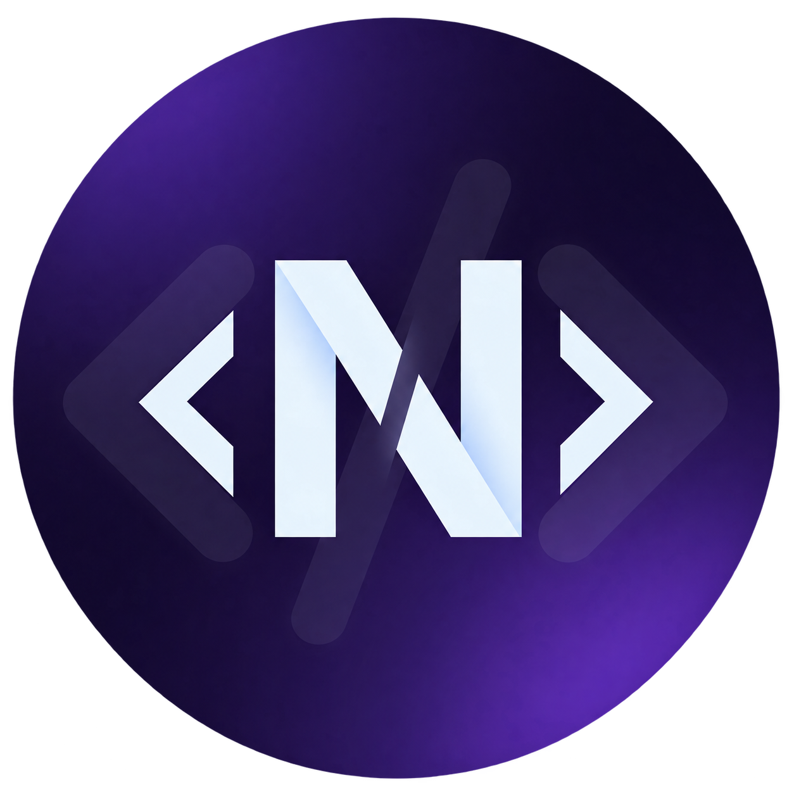
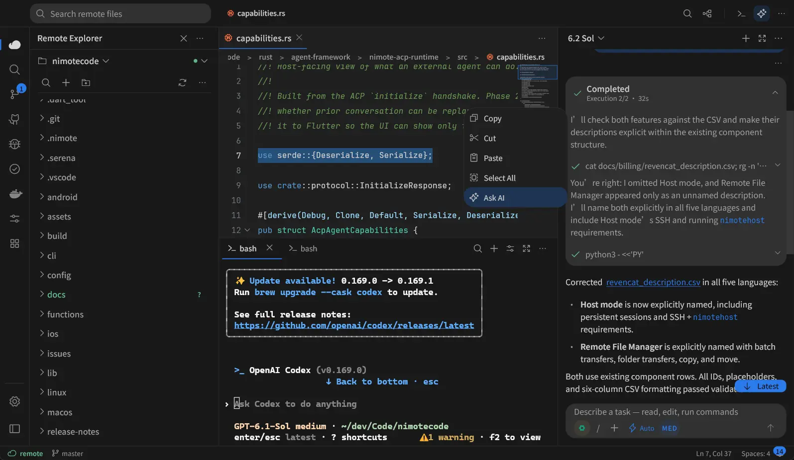

<p align="center">
  
</p>

<h1 align="center">NimoteCode — Mobile IDE for Android &amp; iOS</h1>

<p align="center">English · <a href="README.zh-CN.md">简体中文</a> · <a href="README.es.md">Español</a> · <a href="README.ja.md">日本語</a> · <a href="README.ko.md">한국어</a></p>

<p align="center">
  <strong>A mobile IDE for editing, running and reviewing projects away from your desk.</strong><br>
  Use your local files or connect to a development host over SSH. An editor, terminal, Git<br>
  and AI coding agent share one workspace on Android, iPhone and iPad.
</p>

<p align="center"><sub>Code Editor&nbsp;&nbsp;•&nbsp;&nbsp;SSH Terminal&nbsp;&nbsp;•&nbsp;&nbsp;Git&nbsp;&nbsp;•&nbsp;&nbsp;AI Coding<br>Root-free Ubuntu on supported Android devices</sub></p>

<p align="center">
  <a href="https://play.google.com/store/apps/details?id=com.nimote.nimotecode"></a>
  <a href="https://apps.apple.com/app/nimotecode-ssh-client-ide/id6776158253"></a>
</p>

<p align="center"><sub>
  <a href="#demo">Watch demo</a> ·
  <a href="#compare-mobile-development-tools">Compare tools</a> ·
  <a href="https://nimotecode.com/docs/quick-start?utm_source=github&amp;utm_medium=referral&amp;utm_campaign=readme&amp;utm_content=en_quick_start">Quick start</a> ·
  <a href="#latest-release">What's new in 2.3.0</a>
</sub></p>

<p align="center"><sub>Free to start. AI setup is optional.<br>Commercial, closed-source app · Official documentation and community resources</sub></p>

<p align="center">
  
</p>

---

## Demo

The screenshot above shows the mobile AI Agent and tablet SSH workspace. Watch the workspace in action below, or [open the demo video](https://github.com/user-attachments/assets/df7de976-e743-415d-9bd1-df396a647e10).

<div align="center">
  <video src="https://github.com/user-attachments/assets/df7de976-e743-415d-9bd1-df396a647e10" controls muted playsinline width="420"></video>
</div>

## Develop wherever your project lives

NimoteCode brings a code editor, SSH terminal, Git review and AI workflows to Android, iPhone and iPad. Inspect a project, make a focused change, run the available checks and review the result without switching between separate mobile tools.

<a id="choose-your-first-development-task"></a>

- **Edit a local project.** Open a folder on your device with the system picker, browse files and start editing. No remote host is needed to get started; running code depends on the tools available in your workspace.
- **Connect to your development host over SSH.** Work with remote project files, use the host's terminal and inspect Git changes. Follow the [SSH remote development guide](resources/remote-development-from-phone.md) to edit and verify a change. Requires a reachable, configured SSH host.
- **Run Linux on Android without root.** Use bundled Ubuntu through PRoot, with Bash, Git and SSH, on supported Android 8+ ARM64 / x86_64 devices. Share app-local projects with Linux at `/mnt/local`. [Try your first Linux script](resources/android-linux-development.md). Local Linux is unavailable on iPhone and iPad.

> ⭐ **Useful for your mobile workflow? Star this repository to keep the guides and examples handy.**

## Feature highlights

- **Choose your view:** switch between IDE, Terminal and AI modes while keeping your project and Explorer state.
- **Develop with containers:** manage Docker and Compose on an SSH host, or create and rebuild a Dev Container from `devcontainer.json`.
- **Edit and navigate:** use the same Nimote Editor on phone, tablet, and desktop; browse and search project files, use split editor panes, and preview Markdown and web output.
- **Run and inspect:** use the terminal and project tasks in a compatible workspace, with mobile extra keys, terminal focus mode, configurable color palettes, and SOCKS5 or HTTP CONNECT SSH proxies when needed.
- **Review with Git:** inspect status, diffs and history; search for, create, and check out branches from the Git header; use Early Access workflows to commit, pull, push and resolve conflicts.
- **Extend the workspace:** use Early Access Plugin Center to create custom panels, forms, workflows, artifact views, and local or SSH script jobs, with permission changes reviewed before installation or updates.
- **Use language tools:** connect supported language servers for editor diagnostics and configured remote debug adapters for debugging. LSP and debugging are available through Early Access and require the appropriate environment tools.
- **Work with AI:** ask about code, delegate a bounded task to the built-in Agent, or use compatible agents on your SSH host.

System-granted external folders support browsing and editing; Git, LSP, debugging, Tasks, file watching and Agent workflows need a native filesystem path. Tool availability depends on the workspace, installed tools and plan. See the [feature reference](https://nimotecode.com/features?utm_source=github&utm_medium=referral&utm_campaign=readme&utm_content=en_features) for details.

## AI coding, your way

| Workflow | How to use it |
| --- | --- |
| **AI Chat** | Explain code and terminal output with workspace context. Connect your own AI provider and API key. |
| **Built-in Agent** | Inspect files, plan changes, edit and run checks in a supported workspace; continue an active run with follow-up instructions and answer its interactive questions. Available through Early Access. |
| **MCP tool servers** | Configure verified MCP servers for the built-in Agent on a local or SSH workspace; every tool call requires explicit approval. Available through Early Access. |
| **External ACP agent** | Connect a compatible runtime on your SSH host; review permissions and progress in the app's conversation view. |
| **Claude Code / Codex over SSH** | Run a CLI installed on your own host through the terminal. Follow the [Claude Code on phone](resources/claude-code-on-phone.md) guide. |

AI model access and tokens are not included. Provider charges are separate. External agents and CLIs require their own installation, authentication and service access; Claude Code and Codex are not bundled with NimoteCode. Review commands and diffs before accepting AI-generated changes.

## Quick start

1. **Install:** [Android — Google Play](https://play.google.com/store/apps/details?id=com.nimote.nimotecode) · [iPhone / iPad — App Store](https://apps.apple.com/app/nimotecode-ssh-client-ide/id6776158253).
2. **Open a workspace:** choose a local project, connect an SSH host, or explore the Demo workspace. Supported Android devices can also use Local Linux. You can start without configuring AI.
3. **Make one small change:** open a file, edit it, run a check if your environment supports it, then inspect the Git diff in a Git repository.

> [**Follow the quick start →**](https://nimotecode.com/docs/quick-start?utm_source=github&utm_medium=referral&utm_campaign=readme&utm_content=en_get_started)

**Free to start, with advanced workflows through Early Access:** Free includes local and SSH workspaces, the editor, baseline terminal, Git review, AI Chat and basic Tasks. Advanced workflows such as GitHub integration, Android Local Linux, AI Agent, remote content search, multiple terminals, Git writes, LSP and debugging are available through Early Access. Check [Early Access details](https://nimotecode.com/pro?utm_source=github&utm_medium=referral&utm_campaign=readme&utm_content=en_plans) and the app for current availability and terms.

## Downloads

Get NimoteCode from [Google Play](https://play.google.com/store/apps/details?id=com.nimote.nimotecode) for Android or the [App Store](https://apps.apple.com/app/nimotecode-ssh-client-ide/id6776158253) for iPhone and iPad.

Store availability and release timing may differ by platform and region. See [download and platform requirements](https://nimotecode.com/download?utm_source=github&utm_medium=referral&utm_campaign=readme&utm_content=en_download); the version offered by your store may differ from the release documented below.

<a id="latest-release"></a>

## NimoteCode 2.3.0 · Workspace modes, Docker, and Dev Containers

Workspace modes for IDE, Terminal, and AI, plus Windows SSH, upgraded plugins, interactive Agent follow-ups, terminal improvements, and Docker development on SSH hosts.

- **Switch workspace modes:** move between IDE, Terminal, and AI while keeping the current project and Explorer state.
- **Develop with Docker over SSH:** manage containers, images, volumes, networks, and Compose services; inspect logs and statistics, open exec, and search Docker Hub.
- **Use Dev Containers:** create or rebuild from `devcontainer.json` and open an isolated, configured workspace.
- **More capable workflows:** Windows SSH, validated plugin contributions and Agent tools, ACP Agent follow-ups, adaptive terminal panes, and mobile Git review.

> [Read the full 2.3.0 release notes](https://nimotecode.com/releases/2.3.0) · [Earlier releases](https://nimotecode.com/releases/)

## Documentation

- [Quick start](https://nimotecode.com/docs/quick-start) · [SSH](https://nimotecode.com/docs/ssh) · [Terminal](https://nimotecode.com/docs/terminal) · [Editor](https://nimotecode.com/docs/editor)
- [AI Chat and Agent](https://nimotecode.com/docs/ai) · [Source control](https://nimotecode.com/docs/source-control) · [LSP](https://nimotecode.com/docs/lsp) · [Debugging](https://nimotecode.com/docs/debug)
- [Docker](https://nimotecode.com/docs/docker) · [Plugins](https://nimotecode.com/docs/plugins) · [Security](https://nimotecode.com/docs/security) · [All documentation](https://nimotecode.com/docs)

### Guides and resources

- [Mobile development guides](resources/README.md) — local editing, remote development, Git and AI workflows.
- [Android Local Linux documentation](https://nimotecode.com/docs/local-linux) — setup, compatibility and troubleshooting.
- [Linux Presets](https://github.com/mobiledevloperlab/nimote-linux-presets) — optional environments with versioned manifests and verification scripts; see the [preset overview](presets/README.md).
- [Official website](https://nimotecode.com?utm_source=github&utm_medium=referral&utm_campaign=readme&utm_content=en_website) — product details and documentation.

## FAQ

**How does NimoteCode differ from Termux, Acode and code-server?** NimoteCode combines a touch-oriented editor, SSH client, terminal, Git and AI workflows in one mobile app, with optional Android Local Linux. Termux focuses on an Android terminal and packages; Acode is a mobile code editor; code-server runs VS Code in a browser. Choose based on the environment and workflow you need.

**Do I need an SSH server?** No. Open a local folder or the Demo workspace first. An SSH workspace needs a reachable host with SSH configured.

**Can I run code on my phone?** Supported Android devices can use Local Linux. On iPhone and iPad, use a suitable remote host over SSH. Execution depends on the tools installed in the workspace.

**Is AI included?** AI setup is optional. Bring your own provider and API key; model usage may incur separate charges. The built-in Agent is an Early Access feature.

**Is NimoteCode open source?** The app is commercial and closed source. This repository contains documentation and resources; see [About this repository](#about-this-repository) for licensing details.

[More answers in the FAQ](https://nimotecode.com/docs/faq).

## Compare mobile development tools

**Edit → Run checks → Review the diff → extend the workspace, in one mobile IDE.** These selected capabilities from our detailed comparison help you choose the right tool for your workflow. The NimoteCode column reflects 2.3.0; question marks mean the corresponding capability has not been verified for that product.

✅ Documented built-in or integrated capability · ◐ Conditional · ? Not verified, **not an absence claim** · — Explicitly unsupported

| Key capability | **NimoteCode** | Termius | Blink Shell | ServerCC |
| --- | :---: | :---: | :---: | :---: |
| SSH connection | ✅ | ✅ | ✅ | ✅ |
| Code editor | ✅ | ? | ✅ | ? |
| Custom plugins / workspace panels | ✅ ¹ | ? | ? | ? |
| Git / diff UI | ✅ ¹ | ? | ◐ | ✅ |
| Git branch search / create / checkout | ✅ ¹ | ? | ? | ? |
| Built-in AI agent | ✅ ¹ | ? | ? | ? |
| Continue an active AI Agent run | ✅ ¹ | ? | ? | ? |
| Built-in MCP tool servers | ✅ ¹ | ? | ? | ? |
| LSP diagnostics | ✅ ¹ | ? | ◐ | ? |
| Web / app preview | ✅ | ? | ? | ✅ |
| SSH via SOCKS5 / HTTP CONNECT proxy | ✅ | ? | ? | ? |
| Android Local Linux | ✅ ² | ? | ? | ? |
| Mosh transport | ? | ✅ | ✅ | ? |

<details>
<summary>Compare Redock, Orca and Moshi</summary>

| Key capability | **NimoteCode** | Redock | Orca | Moshi |
| --- | :---: | :---: | :---: | :---: |
| SSH connection | ✅ | ✅ | ◐ | ✅ |
| Code editor | ✅ | ? | — | ? |
| Custom plugins / workspace panels | ✅ ¹ | ? | ? | ? |
| Git / diff UI | ✅ ¹ | ? | ✅ | ✅ |
| Git branch search / create / checkout | ✅ ¹ | ? | ? | ? |
| Built-in AI agent | ✅ ¹ | ? | ? | ? |
| Continue an active AI Agent run | ✅ ¹ | ? | ? | ? |
| Built-in MCP tool servers | ✅ ¹ | ? | ? | ? |
| LSP diagnostics | ✅ ¹ | ? | ? | ? |
| Web / app preview | ✅ | ✅ | ✅ | ✅ |
| SSH via SOCKS5 / HTTP CONNECT proxy | ✅ | ? | ? | ? |
| Android Local Linux | ✅ ² | ? | ? | ? |
| Mosh transport | ? | ✅ | ? | ✅ |

Orca mobile requires its desktop companion. Moshi's diff and web preview require Pro and a host hook. Redock's preview uses a host development server.

</details>

¹ **Early Access:** NimoteCode’s Plugin Center, built-in Agent (including active-run follow-ups and configured MCP tool servers), Git writes and LSP are available through Early Access; Git status, diffs and history are free. Check the app for current availability. ² Local Linux requires supported Android 8+ ARM64 / x86_64 devices. The built-in Agent needs your own AI provider; LSP needs a configured host language server.

A check does not mean free, setup-free or available on every platform. Blink integrates editing through Blink Code; Git / LSP depend on repository or remote IDE configuration. Termius Mosh is verified here for Android only. See the full comparison for each product's setup and plan requirements.

> [**See all seven tools and feature-by-feature official evidence →**](https://nimotecode.com/compare/mobile-ai-development-tools?utm_source=github&utm_medium=referral&utm_campaign=readme&utm_content=en_comparison) · Competitor evidence baseline: 2026-10-19; NimoteCode capabilities: 2.3.0.

**Try the workflow yourself:** [install NimoteCode](https://nimotecode.com/download?utm_source=github&utm_medium=referral&utm_campaign=readme&utm_content=en_compare_download) and open a demo or local project. No AI setup needed to start.

## Contributing

Contributions to the documentation and examples in this repository are welcome. Open a pull request for a correction, or use the [issue tracker](https://github.com/mobiledevloperlab/nimote_issues/issues) to report an app problem or suggest a feature. Include steps to reproduce and your device and app version when reporting a bug. The application source is not in this repository.

## Community

Share a bug, ask a question or suggest a workflow you would like to see supported.

<p align="center">
  <a href="https://discord.gg/tTxbpqYmhR">Discord</a> ·
  <a href="https://github.com/mobiledevloperlab/nimote_issues/issues">Report an issue</a> ·
  <a href="https://x.com/mobiledevlab">X</a>
</p>

<p align="center">
  <b>Star to bookmark these mobile development resources and support NimoteCode.</b><br>
  <a href="https://github.com/mobiledevloperlab/nimotecode"></a>
</p>

## About this repository

NimoteCode is a commercial, closed-source application. This repository contains official documentation, tutorials, workflow examples and release notes. The application source code is not published here. Linux presets are maintained in a separate repository, and bug reports use the issue tracker linked above.

Published [Local Linux source bundles and license notices](https://nimotecode.com/docs/local-linux-source) cover third-party components; they do not make the NimoteCode application open source. The separate [Linux Presets MIT license](https://github.com/mobiledevloperlab/nimote-linux-presets/blob/master/LICENSE) applies to that repository, not to the app or all content here.

<details>
<summary>Maintain the website and docs</summary>

```bash
nvm install
nvm use
npm ci
npm ci --prefix blog
npm run docs:build
npm run docs:check
```

Use Node 24 (`.nvmrc`), matching deployment. Astro requires Node >=22.23.4; Node 20 is unsupported. Run `nvm use` after opening a new terminal in this repository.

Use `npm run docs:dev` to preview locally.

</details>
