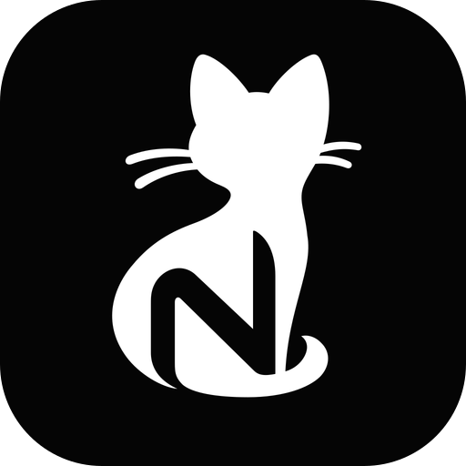
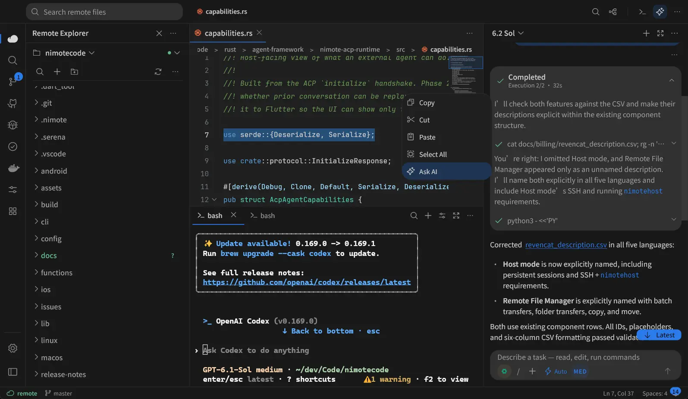

<p align="center">
  
</p>

<h1 align="center">NimoteCode — Android / iOS 移动 IDE</h1>

<p align="center"><a href="README.md">English</a> · 简体中文 · <a href="README.es.md">Español</a> · <a href="README.ja.md">日本語</a> · <a href="README.ko.md">한국어</a></p>

<p align="center">
  <strong>在手机和平板上编辑、运行和审查项目的移动 IDE。</strong><br>
  打开本地文件或通过 SSH 连接开发主机，在同一工作区使用编辑器、终端、Git 和 AI 编程 Agent。
</p>

<p align="center"><sub>代码编辑器&nbsp;&nbsp;•&nbsp;&nbsp;SSH 终端&nbsp;&nbsp;•&nbsp;&nbsp;Git&nbsp;&nbsp;•&nbsp;&nbsp;AI 编码<br>支持的 Android 设备还可运行免 root Ubuntu</sub></p>

<p align="center">
  <a href="https://play.google.com/store/apps/details?id=com.nimote.nimotecode"></a>
  <a href="https://apps.apple.com/app/nimotecode-ssh-client-ide/id6776158253"></a>
</p>

<p align="center"><sub><a href="#演示">观看演示</a> · <a href="#nimotehost">NimoteHost</a> · <a href="#与其他移动开发工具对比">工具对比</a> · <a href="https://nimotecode.com/zh/docs/quick-start?utm_source=github&amp;utm_medium=referral&amp;utm_campaign=readme&amp;utm_content=zh_quick_start">快速开始</a> · <a href="#latest-release">2.4.1 预告</a></sub></p>

<p align="center"><sub>免费开始使用，无需先配置 AI。<br>商业闭源应用 · 配套 NimoteHost 完整源码以 Apache-2.0 开源</sub></p>

<p align="center">
  
</p>

---

## 演示

上方截图展示了手机上的 AI Agent 和平板上的 SSH 工作区。可在下方观看，或[直接打开演示视频](https://github.com/user-attachments/assets/df7de976-e743-415d-9bd1-df396a647e10)。

<div align="center">
  <video src="https://github.com/user-attachments/assets/df7de976-e743-415d-9bd1-df396a647e10" controls muted playsinline width="420"></video>
</div>

## 项目在哪里，就在哪里继续开发

NimoteCode 将代码编辑器、SSH 终端、Git 审查与 AI 工作流带到 Android、iPhone 和 iPad。查看项目、完成一处修改、运行环境支持的检查，再审查结果，让这些操作在同一个移动应用中衔接起来。

<a id="选择你的第一个开发任务"></a>

- **编辑设备上的本地项目。** 通过系统选择器打开项目目录，浏览文件并开始编辑，无需先准备远程主机。代码能否运行取决于当前工作区可用的工具。
- **通过 SSH 连接开发主机。** 编辑远程项目文件，使用主机终端，检查 Git 改动。按 [SSH 远程开发教程](resources/remote-development-from-phone.md)完成一次修改与验证；需要已配置且可访问的 SSH 主机。
- **在 Android 上免 root 运行 Linux。** 在受支持的 Android 8+ ARM64 / x86_64 设备上，通过 PRoot 使用内置 Ubuntu、Bash、Git 和 SSH，并在 `/mnt/local` 与应用本地项目共享文件。[运行你的第一个 Linux 脚本](resources/android-linux-development.md)。iPhone 和 iPad 不支持 Local Linux。

> ⭐ **这些工作流对你有帮助？欢迎 Star 收藏，方便再次找到教程与示例。**

## 功能亮点

- **远程任务持续运行：**通过可选的 [NimoteHost](https://nimotecode.com/zh/docs/host) 托管终端、任务与兼容 Agent，断线后重新连接继续工作；计划随 2.4.1 提供。
- **切换工作区模式：**按任务选择 IDE、终端、AI 或 Host；IDE、终端与 AI 保留项目与文件浏览器状态，Host 连接 NimoteHost 托管的工作。
- **容器开发：**通过 SSH 管理 Docker 与 Compose，或根据 `devcontainer.json` 创建和重建 Dev Container。
- **编辑与浏览：**在手机、平板与桌面统一使用 Nimote Editor；浏览和搜索项目文件，使用编辑器分屏，预览 Markdown 与网页内容。
- **运行与检查：**在兼容的工作区中使用终端和项目任务，配合移动端扩展按键、终端专注模式、可配置配色，以及按需使用 SOCKS5 或 HTTP CONNECT SSH 代理。
- **Git 审查：**查看状态、Diff 和历史；可在 Git 标题栏搜索、创建和切换分支；通过 Early Access 工作流提交、拉取、推送及解决冲突。
- **扩展工作台：**通过 Early Access 插件中心创建自定义面板、表单、工作流、产物视图及本机或 SSH 脚本任务；安装或更新前会先审查权限变更。
- **语言工具：**接入受支持的语言服务器查看编辑器诊断，配置远程调试适配器进行调试。LSP 与调试通过 Early Access 开放，并需要相应环境工具。
- **AI 辅助开发：**询问代码问题、让内置 Agent 完成范围明确的任务，或使用 SSH 主机上的兼容 Agent。

通过系统选择器授权的外部目录支持浏览与编辑；Git、LSP、调试、Tasks、文件监听与 Agent 需要原生文件路径。具体工具取决于工作区、环境与权益。详见[功能说明](https://nimotecode.com/zh/features?utm_source=github&utm_medium=referral&utm_campaign=readme&utm_content=zh_features)。

<a id="nimotehost"></a>

## NimoteHost：让工作在自己的电脑上继续

从手机发起构建或编程 Agent，离开应用后，再回到原来的工作。**NimoteHost** 是可选的自部署配套服务，支持 Linux、macOS、Windows，提供独立 CLI 和桌面管理器。任务使用电脑上的项目文件和工具运行，手机通过已有 SSH 连接操作。

- **断线后接续工作：** 重新连接仍在运行的终端、任务日志和兼容 Agent 对话。
- **审查 Agent 操作：** 使用电脑上已安装的兼容 Codex、Claude Code、OpenCode，查看结构化工具输出、回复权限请求，并在支持时追加指令。
- **跟进任务结果：** 搜索和固定会话，查看任务收件箱、验证记录与 Diff，并在主机支持时从 GitHub Issue 派发工作。
- **自行部署和扩展：** 选择 CLI 或桌面包、从源码构建，或通过 RPC、Go 客户端包、MCP 与社区插件接入自己的工具。

**Host 模式将随即将发布的 2.4.1 提供。** NimoteHost 完整源码以 **Apache-2.0** 许可证在 [mobiledevloperlab/nimotehost](https://github.com/mobiledevloperlab/nimotehost) 开源；NimoteCode 应用仍为商业闭源软件。源码和二进制包将在公开发布后可用，仓库显示 404 或发布页为空时，表示公开安装入口尚未开放。

开始使用：在开发电脑安装完整兼容 Host 包，检查 `status` 和 `capabilities`，再在 NimoteCode 选择 **Host → SSH connections**，使用同一个系统账号连接。普通 SSH 工作区无需安装 Host。

Host 和电脑需要保持运行：客户端断线仅断开连接，Host 或系统重启会中断进程。Agent 工具、登录及模型费用另行配置；具体入口取决于 App 和 Host 版本。

**可审查、可自定义、可共建：** Host 服务端、CLI、桌面管理器与 SDK 均提供完整源码。可以自行编译、Fork 修改部署与行为、接入自己的工具，并按 [Host 贡献指南](https://github.com/mobiledevloperlab/nimotehost/blob/master/CONTRIBUTING.zh-CN.md)贡献修复、Agent 适配、翻译和文档。SSH 认证、本机回环 API 认证与本地 Host 凭据让访问由你管理；模型工具仍使用各自配置的服务商。

[**安装、部署、使用与故障排查 →**](https://nimotecode.com/zh/docs/host) · [Host 源码与许可证](https://github.com/mobiledevloperlab/nimotehost) · [发布包下载](https://github.com/mobiledevloperlab/nimotehost/releases)

## 按你的习惯使用 AI

| 工作流 | 使用方式 |
| --- | --- |
| **AI Chat** | 结合工作区上下文解释代码与终端输出；连接自己的 AI Provider 和 API Key。 |
| **内置 Agent** | 在支持的工作区中检查文件、规划修改、编辑与运行检查；可向正在执行的任务追加指令，并回答其交互式问题。通过 Early Access 开放。 |
| **MCP 工具服务器** | 可在本地或 SSH 工作区为内置 Agent 配置经验证的 MCP 服务器；每次工具调用均需明确批准。通过 Early Access 开放。 |
| **外部 ACP Agent** | 连接 SSH 主机上的兼容运行时，在应用对话界面查看权限请求与执行进度。 |
| **通过 SSH 使用 Claude Code / Codex** | 在自己的主机上安装 CLI，通过终端使用；参考 [Claude Code 手机使用指南](resources/claude-code-on-phone.md)。 |

应用不包含 AI 模型访问权限或 Token 额度，Provider 费用另计。外部 Agent 与 CLI 需要单独安装、认证并具备相应服务权限；Claude Code 和 Codex 并非 NimoteCode 内置工具。接受 AI 修改前，请检查命令与代码 Diff。

## 快速开始

1. **安装应用：**[Android — Google Play](https://play.google.com/store/apps/details?id=com.nimote.nimotecode) · [iPhone / iPad — App Store](https://apps.apple.com/app/nimotecode-ssh-client-ide/id6776158253)。
2. **打开工作区：**选择本地项目、连接 SSH 主机，或先体验 Demo 工作区；支持的 Android 设备也可使用 Local Linux。无需先配置 AI。
3. **完成一处小修改：**打开文件并编辑，在环境支持时运行检查，再在 Git 仓库中审查 Diff。

> [**跟随快速开始教程 →**](https://nimotecode.com/zh/docs/quick-start?utm_source=github&utm_medium=referral&utm_campaign=readme&utm_content=zh_get_started)

**免费开始，Early Access 体验进阶功能：**免费版包含本地与 SSH 工作区、编辑器、基础终端、Git 审查、AI Chat 和基础 Tasks。GitHub 集成、Android Local Linux、AI Agent、远程内容搜索、多终端、Git 写操作、LSP 和调试等进阶工作流通过 Early Access 开放。当前可用性与权益以[Early Access 权益说明](https://nimotecode.com/zh/pro?utm_source=github&utm_medium=referral&utm_campaign=readme&utm_content=zh_plans)及应用内显示为准。

商店可用性与版本上线时间可能因平台和地区不同。查看[下载与平台要求](https://nimotecode.com/zh/download?utm_source=github&utm_medium=referral&utm_campaign=readme&utm_content=zh_download)；商店实际提供的版本可能与下方介绍的版本不同。

## 下载

Android 用户可从 [Google Play](https://play.google.com/store/apps/details?id=com.nimote.nimotecode) 安装，iPhone 和 iPad 用户可从 [App Store](https://apps.apple.com/app/nimotecode-ssh-client-ide/id6776158253) 下载。

<a id="latest-release"></a>

[Host 模式: 安装 NimoteHost，通过 SSH 连接，创建终端、运行任务和使用 Agent。](https://nimotecode.com/zh/docs/host)

**即将发布：NimoteCode 2.4.1**，包含尚未公开发布的 2.4.0 功能；Windows、macOS、Linux 版 NimoteCode 及 NimoteHost 也即将发布，具体时间另行公布。

## NimoteCode 2.4.1 · 即将发布

- **工作流进一步完善。** 支持搜索保留的终端历史、资源管理器 Git 状态着色，改善终端选择、横屏布局、远程保存与 Windows 多进程稳定性。原生 Host Agent 会话接管为实验功能，需要显式构建开关及兼容的 Host 能力。

- **Host 工作区。** 先在远程机器安装并启动兼容的 NimoteHost，再通过 SSH 浏览、搜索、固定和恢复终端与 Agent 会话。Host 为可选功能，原有 SSH 工作流仍可使用。
- **Host Agent 协作。** 兼容的 Codex、Claude 和 OpenCode 会话提供结构化对话、工具、审批、命令、模型控制和受支持的运行中追问。执行策略取决于 Host 能力，敏感操作仍可能需要确认。
- **任务收件箱与 GitHub Issue。** 查看任务状态、验证证据与 Diff，继续或归档任务，并按所选发布策略派发 GitHub Issue。部分能力取决于 Host 版本和配置。
- **Host 插件。** 从侧边栏访问兼容插件，使用带版本的表单、分页表格、详情和交互界面，并沿用权限校验。
- **项目任务运行器。** 从 package.json、Taskfile、Makefile、justfile 和 .vscode/tasks.json 发现支持的任务，在工作区终端运行；Make/just 动态发现需明确确认。
- **提醒与编辑器偏好。** 配置 Agent 完成、待确认与失败提醒，提示音和震动受系统设置影响；支持编辑器行号和横屏缩略图设置。Windows 默认启用 Pro。
- 统一应用配置入口，管理核心功能、面板和插件；提醒位于 Agent 配置。优化平板与 Windows 布局、横屏配色及减少动态效果支持。
- 按分支和工作流筛选 GitHub CI 运行记录，查看步骤日志、错误上下文及日志不完整提示。
- 优化终端输出响应、同步更新、搜索、滚动、Vim、剪贴板、Windows 粘贴、软键盘及长按导航键。
- 改进会话历史，支持离线删除本地历史条目；优化远程保存及失败原因、长文件编辑，以及带底部导航的换行 Git Diff。

[2.4.1 →](https://nimotecode.com/zh/releases/2.4.1)

## 文档

- [快速开始](https://nimotecode.com/zh/docs/quick-start) · [SSH](https://nimotecode.com/zh/docs/ssh) · [终端](https://nimotecode.com/zh/docs/terminal) · [编辑器](https://nimotecode.com/zh/docs/editor)
- [AI Chat 和 Agent](https://nimotecode.com/zh/docs/ai) · [源代码管理](https://nimotecode.com/zh/docs/source-control) · [LSP](https://nimotecode.com/zh/docs/lsp) · [调试](https://nimotecode.com/zh/docs/debug)
- [Docker](https://nimotecode.com/zh/docs/docker) · [插件](https://nimotecode.com/zh/docs/plugins) · [安全](https://nimotecode.com/zh/docs/security) · [全部文档](https://nimotecode.com/zh/docs)

### 教程与资源

- [移动开发指南](resources/README.md) —— 本地编辑、远程开发、Git 与 AI 工作流（英文）。
- [Android 本地 Linux 文档](https://nimotecode.com/zh/docs/local-linux) —— 安装、兼容性与故障排查。
- [Linux Presets](https://github.com/mobiledevloperlab/nimote-linux-presets) —— 含版本化清单与校验脚本的可选环境；另见[预设概览](presets/README.md)。
- [官方网站](https://nimotecode.com/zh/?utm_source=github&utm_medium=referral&utm_campaign=readme&utm_content=zh_website) —— 产品详情与使用文档。

## 常见问题

**NimoteCode 与 Termux、Acode 和 code-server 有什么区别？** NimoteCode 在移动应用中结合了触屏编辑器、SSH 客户端、终端、Git 和 AI 工作流，并可选用 Android Local Linux。Termux 侧重 Android 终端和软件包；Acode 是移动代码编辑器；code-server 在浏览器中运行 VS Code。可根据所需环境和工作流选择。

**必须有 SSH 服务器吗？** 不需要。可以先打开本地文件夹或 Demo 工作区；SSH 工作区需要已配置且可访问的主机。

**可以在手机上运行代码吗？** 受支持的 Android 设备可以使用 Local Linux；iPhone 和 iPad 可通过 SSH 使用合适的远程主机。能运行什么取决于工作区中安装的工具。

**包含 AI 服务吗？** AI 配置是可选的。需要自备服务商和 API Key，模型使用可能另行收费。内置 Agent 属于 Early Access 功能。

**NimoteCode 是开源的吗？** 应用是商业闭源软件，本仓库提供文档和资源；许可详情见[关于本仓库](#关于本仓库)。独立的 [NimoteHost 配套服务](https://github.com/mobiledevloperlab/nimotehost)完整源码以 Apache-2.0 开源，该许可适用于 Host，不适用于 NimoteCode 应用。

[查看更多常见问题](https://nimotecode.com/zh/docs/faq)。

## 与其他移动开发工具对比

**编辑代码 → 运行检查 → 审查 Diff → 扩展工作台，在一个移动 IDE 中衔接完成。** 以下精选官网对比中的关键能力，帮助你选择适合自己的工具。NimoteCode 一列反映未发布的 2.4.0 构建（将并入 2.4.1）；问号表示尚未核实该产品是否具备对应能力。

✅ 已有文档确认的内置或集成能力 · ◐ 有条件支持 · ? 未核实，**不代表不支持** · — 明确不支持

| 关键能力 | **NimoteCode** | Termius | Blink Shell | ServerCC |
| --- | :---: | :---: | :---: | :---: |
| SSH 连接 | ✅ | ✅ | ✅ | ✅ |
| 代码编辑器 | ✅ | ? | ✅ | ? |
| 自定义插件 / 工作区面板 | ✅ ¹ | ? | ? | ? |
| Git / Diff 界面 | ✅ ¹ | ? | ◐ | ✅ |
| Git 分支搜索 / 创建 / 切换 | ✅ ¹ | ? | ? | ? |
| 内置 AI Agent | ✅ ¹ | ? | ? | ? |
| 持续推进正在运行的 AI Agent | ✅ ¹ | ? | ? | ? |
| 内置 MCP 工具服务器 | ✅ ¹ | ? | ? | ? |
| LSP 诊断 | ✅ ¹ | ? | ◐ | ? |
| Web / App 预览 | ✅ | ? | ? | ✅ |
| SOCKS5 / HTTP CONNECT 代理 SSH | ✅ | ? | ? | ? |
| Android 本地 Linux | ✅ ² | ? | ? | ? |
| Mosh 传输 | ? | ✅ | ✅ | ? |

<details>
<summary>展开对比 Redock、Orca 和 Moshi</summary>

| 关键能力 | **NimoteCode** | Redock | Orca | Moshi |
| --- | :---: | :---: | :---: | :---: |
| SSH 连接 | ✅ | ✅ | ◐ | ✅ |
| 代码编辑器 | ✅ | ? | — | ? |
| 自定义插件 / 工作区面板 | ✅ ¹ | ? | ? | ? |
| Git / Diff 界面 | ✅ ¹ | ? | ✅ | ✅ |
| Git 分支搜索 / 创建 / 切换 | ✅ ¹ | ? | ? | ? |
| 内置 AI Agent | ✅ ¹ | ? | ? | ? |
| 持续推进正在运行的 AI Agent | ✅ ¹ | ? | ? | ? |
| 内置 MCP 工具服务器 | ✅ ¹ | ? | ? | ? |
| LSP 诊断 | ✅ ¹ | ? | ? | ? |
| Web / App 预览 | ✅ | ✅ | ✅ | ✅ |
| SOCKS5 / HTTP CONNECT 代理 SSH | ✅ | ? | ? | ? |
| Android 本地 Linux | ✅ ² | ? | ? | ? |
| Mosh 传输 | ? | ✅ | ? | ✅ |

Orca 的移动端依赖桌面 Companion；Moshi 的 Diff 和网页预览需要 Pro 与主机 Hook；Redock 的预览依赖主机开发服务。

</details>

¹ **Early Access：**NimoteCode 的插件中心、内置 Agent（包括运行中追加指令和已配置的 MCP 工具服务器）、Git 写操作与 LSP 属于 Early Access 权益；Git 状态、Diff 与历史可免费使用。具体开放情况以应用内显示为准。² Local Linux 仅限受支持的 Android 8+ ARM64 / x86_64 设备。内置 Agent 需要自有 AI Provider；LSP 需要配置主机语言服务器。

勾选不代表免费、无需配置或所有平台均支持。Blink 的编辑能力通过 Blink Code 集成，Git / LSP 取决于仓库或远程 IDE 配置；Termius 的 Mosh 此处仅核实 Android。各产品的配置与付费要求见完整对比。

> [**查看七款工具的完整对比与逐项官方依据 →**](https://nimotecode.com/zh/compare/mobile-ai-development-tools?utm_source=github&utm_medium=referral&utm_campaign=readme&utm_content=zh_comparison) · 竞品资料基准：2026-10-19；NimoteCode 能力基准：未发布的 2.4.0 构建，将并入 2.4.1。

**想亲自试试？** [安装 NimoteCode](https://nimotecode.com/zh/download?utm_source=github&utm_medium=referral&utm_campaign=readme&utm_content=zh_compare_download)，先打开 Demo 或本地项目，无需先配置 AI。

## 参与贡献

欢迎通过 Pull Request 改进本仓库的文档和示例，也可以在 [Issue 追踪器](https://github.com/mobiledevloperlab/nimote_issues/issues)报告应用问题或提出功能建议。报告问题时请提供复现步骤、设备和应用版本。应用源代码不在本仓库中。

## 社区

欢迎反馈 Bug、提出问题，或分享你希望支持的移动开发场景。

<p align="center">
  <a href="https://discord.gg/tTxbpqYmhR">Discord</a> ·
  <a href="https://github.com/mobiledevloperlab/nimote_issues/issues">报告问题</a> ·
  <a href="https://x.com/mobiledevlab">X</a>
</p>

<p align="center">
  <b>欢迎 Star 收藏这些移动开发资源，也支持 NimoteCode 持续改进。</b><br>
  <a href="https://github.com/mobiledevloperlab/nimotecode"></a>
</p>

## 关于本仓库

独立的 [NimoteHost 配套服务](https://github.com/mobiledevloperlab/nimotehost)完整源码以 Apache-2.0 开源，该许可适用于 Host，不适用于 NimoteCode 应用。

NimoteCode 是商业闭源应用。本仓库提供官方文档、教程、工作流示例与发布说明，不发布应用源码。Linux 预设在独立仓库维护；Bug 反馈请使用上方的问题追踪入口。

已公开的 [Local Linux 源码包与许可声明](https://nimotecode.com/zh/docs/local-linux-source)属于第三方组件，不代表 NimoteCode 应用开源。独立的 [Linux Presets MIT 许可证](https://github.com/mobiledevloperlab/nimote-linux-presets/blob/master/LICENSE)适用于该预设仓库，不代表应用或本仓库全部内容采用 MIT 许可。

<details>
<summary>维护本站文档</summary>

```bash
nvm install
nvm use
npm ci
npm ci --prefix blog
npm run docs:build
npm run docs:check
```

使用与部署环境一致的 Node 24（见 `.nvmrc`）。Astro 要求 Node >=22.23.4，不支持 Node 20。在新终端进入本仓库后，先运行 `nvm use`。

使用 `npm run docs:dev` 在本地预览。

</details>
