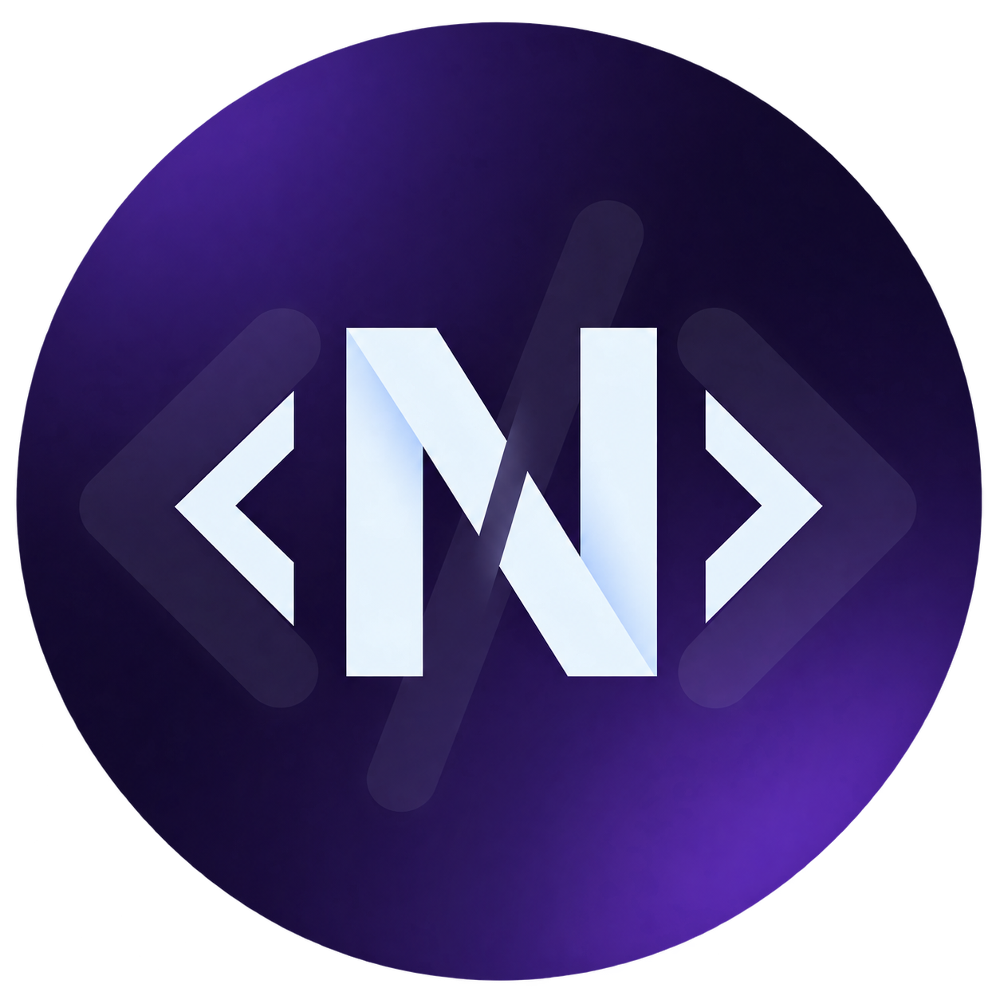
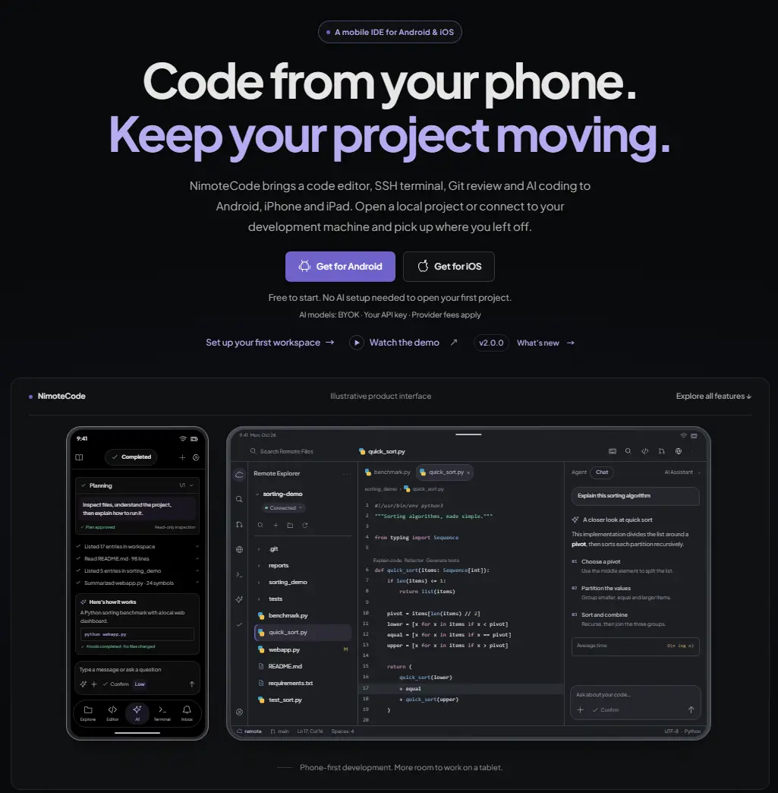

<p align="center">
  
</p>

<h1 align="center">NimoteCode — Android / iOS 移动 IDE</h1>

<p align="center">简体中文 · <a href="README.md">English</a></p>

<p align="center"><b>在手机和平板上，继续你的开发工作。</b><br>打开本地项目，或通过 SSH 连接开发主机。<br>在同一个移动工作区中编辑代码、运行命令、审查 Git 改动，并使用 AI 辅助开发。</p>

<p align="center">代码编辑器 · SSH 终端 · Git · AI 编码<br>支持的 Android 设备还可运行免 root Ubuntu</p>

<p align="center">
  <a href="https://play.google.com/store/apps/details?id=com.nimote.nimotecode"></a>
  <a href="https://apps.apple.com/app/nimotecode-ssh-client-ide/id6776158253"></a>
</p>

<p align="center"><a href="#演示">观看演示</a> · <a href="#与其他移动开发工具对比">工具对比</a> · <a href="https://nimotecode.com/zh/docs/quick-start?utm_source=github&amp;utm_medium=referral&amp;utm_campaign=readme&amp;utm_content=zh_quick_start">快速开始</a> · <a href="#125-更新亮点">1.2.5 更新亮点</a></p>

<p align="center">免费开始使用，无需先配置 AI。<br><small>商业闭源应用 · 本仓库提供官方文档与社区资源</small></p>

<p align="center">
  
</p>

## 演示

<div align="center" style="padding: 24px 16px; background: radial-gradient(ellipse at center, rgba(56, 139, 253, 0.16) 0%, rgba(56, 139, 253, 0) 72%);">
  <video src="https://github.com/user-attachments/assets/531d62fc-4874-41b9-96af-1ac9d2ad6fd6" controls muted playsinline width="420" poster="docs/public/videos/nimotecode-poster.jpg" style="display: block; max-width: 100%; margin: 0 auto; border: 1px solid rgba(56, 139, 253, 0.28); border-radius: 16px; box-shadow: 0 12px 32px rgba(27, 31, 35, 0.18);">
    打开 <a href="https://github.com/user-attachments/assets/531d62fc-4874-41b9-96af-1ac9d2ad6fd6">AI Agent 演示视频</a>。
  </video>
</div>

[观看 AI Agent 产品演示](https://github.com/user-attachments/assets/531d62fc-4874-41b9-96af-1ac9d2ad6fd6) · [备用 MP4 视频](https://nimotecode.com/videos/ai-agent-demo-small.mp4)

## 项目在哪里，就在哪里继续开发

NimoteCode 将代码编辑器、SSH 终端、Git 审查与 AI 工作流带到 Android、iPhone 和 iPad。查看项目、完成一处修改、运行环境支持的检查，再审查结果，让这些操作在同一个移动应用中衔接起来。

<a id="选择你的第一个开发任务"></a>

- **编辑设备上的本地项目。** 通过系统选择器打开项目目录，浏览文件并开始编辑，无需先准备远程主机。代码能否运行取决于当前工作区可用的工具。
- **通过 SSH 连接开发主机。** 编辑远程项目文件，使用主机终端，检查 Git 改动。按 [SSH 远程开发教程](resources/remote-development-from-phone.md)完成一次修改与验证；需要已配置且可访问的 SSH 主机。
- **在 Android 上免 root 运行 Linux。** 在受支持的 Android 8+ ARM64 / x86_64 设备上，通过 PRoot 使用内置 Ubuntu、Bash、Git 和 SSH，并在 `/mnt/local` 与应用本地项目共享文件。[运行你的第一个 Linux 脚本](resources/android-linux-development.md)。iPhone 和 iPad 不支持 Local Linux。

⭐ **这些工作流对你有帮助？欢迎 Star 收藏，方便再次找到教程与示例。**

## 与其他移动开发工具对比

**编辑代码 → 运行检查 → 审查 Diff，在一个移动工作区衔接完成。** 以下精选官网对比中的关键能力，帮助你选择适合自己的工具。

✅ 已有文档确认的内置或集成能力 · ◐ 有条件支持 · ? 未核实，**不代表不支持** · — 明确不支持

| 关键能力 | **NimoteCode** | Termius | Blink Shell | ServerCC |
| --- | :---: | :---: | :---: | :---: |
| SSH 连接 | ✅ | ✅ | ✅ | ✅ |
| 代码编辑器 | ✅ | ? | ✅ | ? |
| Git / Diff 界面 | ✅ ¹ | ? | ◐ | ✅ |
| 内置 AI Agent | ✅ ¹ | ? | ? | ? |
| LSP 诊断 | ✅ ¹ | ? | ◐ | ? |
| Web / App 预览 | ✅ | ? | ? | ✅ |
| Android 本地 Linux | ✅ ² | ? | ? | ? |
| Mosh 传输 | ? | ✅ | ✅ | ? |

<details>
<summary>展开对比 Redock、Orca 和 Moshi</summary>

| 关键能力 | **NimoteCode** | Redock | Orca | Moshi |
| --- | :---: | :---: | :---: | :---: |
| SSH 连接 | ✅ | ✅ | ◐ | ✅ |
| 代码编辑器 | ✅ | ? | — | ? |
| Git / Diff 界面 | ✅ ¹ | ? | ✅ | ✅ |
| 内置 AI Agent | ✅ ¹ | ? | ? | ? |
| LSP 诊断 | ✅ ¹ | ? | ? | ? |
| Web / App 预览 | ✅ | ✅ | ✅ | ✅ |
| Android 本地 Linux | ✅ ² | ? | ? | ? |
| Mosh 传输 | ? | ✅ | ? | ✅ |

Orca 的移动端依赖桌面 Companion；Moshi 的 Diff 和网页预览需要 Pro 与主机 Hook；Redock 的预览依赖主机开发服务。

</details>

¹ **Early Access：**NimoteCode 的内置 Agent、Git 写操作与 LSP 属于 Early Access 权益；Git 状态、Diff 与历史可免费使用。具体开放情况以应用内显示为准。² Local Linux 仅限受支持的 Android 8+ ARM64 / x86_64 设备。内置 Agent 需要自有 AI Provider；LSP 需要配置主机语言服务器。

勾选不代表免费、无需配置或所有平台均支持。Blink 的编辑能力通过 Blink Code 集成，Git / LSP 取决于仓库或远程 IDE 配置；Termius 的 Mosh 此处仅核实 Android。各产品的配置与付费要求见完整对比。

[**查看七款工具的完整对比与逐项官方依据 →**](https://nimotecode.com/zh/compare/mobile-ai-development-tools?utm_source=github&utm_medium=referral&utm_campaign=readme&utm_content=zh_comparison) · 资料基准：2026-10-19，NimoteCode 1.2.4。

**想亲自试试？** [安装 NimoteCode](https://nimotecode.com/zh/download?utm_source=github&utm_medium=referral&utm_campaign=readme&utm_content=zh_compare_download)，先打开 Demo 或本地项目，无需先配置 AI。

## 为什么值得一试

- **编辑与浏览：**浏览和搜索项目文件，使用编辑器分屏，预览 Markdown 与网页内容。
- **运行与检查：**在兼容的工作区中使用终端和项目任务，配合移动端扩展按键与终端专注模式。
- **Git 审查：**查看状态、Diff 和历史；通过 Early Access 工作流提交、拉取、推送及解决冲突。
- **语言工具：**接入受支持的语言服务器查看编辑器诊断，配置远程调试适配器进行调试。LSP 与调试通过 Early Access 开放，并需要相应环境工具。
- **AI 辅助开发：**询问代码问题、让内置 Agent 完成范围明确的任务，或使用 SSH 主机上的兼容 Agent。

通过系统选择器授权的外部目录支持浏览与编辑；Git、LSP、调试、Tasks、文件监听与 Agent 需要原生文件路径。具体工具取决于工作区、环境与权益。详见[功能说明](https://nimotecode.com/zh/features?utm_source=github&utm_medium=referral&utm_campaign=readme&utm_content=zh_features)。

## 按你的习惯使用 AI

| 工作流 | 使用方式 |
| --- | --- |
| **AI Chat** | 结合工作区上下文解释代码与终端输出；连接自己的 AI Provider 和 API Key。 |
| **内置 Agent** | 在支持的工作区中检查文件、规划修改、编辑与运行检查，通过 Early Access 开放。 |
| **外部 ACP Agent** | 连接 SSH 主机上的兼容运行时，在应用对话界面查看权限请求与执行进度。 |
| **通过 SSH 使用 Claude Code / Codex** | 在自己的主机上安装 CLI，通过终端使用；参考 [Claude Code 手机使用指南](resources/claude-code-on-phone.md)或 [Codex 移动端示例](examples/codex-over-ssh/README.md)。 |

应用不包含 AI 模型访问权限或 Token 额度，Provider 费用另计。外部 Agent 与 CLI 需要单独安装、认证并具备相应服务权限；Claude Code 和 Codex 并非 NimoteCode 内置工具。接受 AI 修改前，请检查命令与代码 Diff。

## 从第一个项目开始

1. **安装应用：**[Android — Google Play](https://play.google.com/store/apps/details?id=com.nimote.nimotecode) · [iPhone / iPad — App Store](https://apps.apple.com/app/nimotecode-ssh-client-ide/id6776158253)。
2. **打开工作区：**选择本地项目、连接 SSH 主机，或先体验 Demo 工作区；支持的 Android 设备也可使用 Local Linux。无需先配置 AI。
3. **完成一处小修改：**打开文件并编辑，在环境支持时运行检查，再在 Git 仓库中审查 Diff。

[**跟随快速开始教程 →**](https://nimotecode.com/zh/docs/quick-start?utm_source=github&utm_medium=referral&utm_campaign=readme&utm_content=zh_get_started)

**免费开始，Early Access 体验进阶功能：**免费版包含本地、SSH 与 Android Local Linux 工作区、编辑器、基础终端、Git 审查、AI Chat 和基础 Tasks。AI Agent、远程内容搜索、多终端、Git 写操作、LSP 和调试等进阶工作流通过 Early Access 开放。当前可用性与权益以[Early Access 权益说明](https://nimotecode.com/zh/pro?utm_source=github&utm_medium=referral&utm_campaign=readme&utm_content=zh_plans)及应用内显示为准。

商店可用性与版本上线时间可能因平台和地区不同。查看[下载与平台要求](https://nimotecode.com/zh/download?utm_source=github&utm_medium=referral&utm_campaign=readme&utm_content=zh_download)；商店实际提供的版本可能与下方介绍的版本不同。

## 1.2.5 更新亮点

**更高效地管理项目，让工作区体验更一致。**

- **批量处理文件：**在资源管理器中选择多个文件或目录，即可统一复制、移动或删除；工作区会按其能力提供操作。
- **更易浏览项目：**资源管理器现显示文件大小和已展开目录的已加载项目数量。
- **更快开始 AI 工作：**可从空白对话直接新建 AI 聊天或打开 AI 配置。
- **反馈更清晰：**SSH 连接会立即显示进度并避免重复尝试，面板、工具栏、Markdown 预览、通知与移动端导航也更一致。

[阅读完整 1.2.5 发布说明](https://nimotecode.com/zh/releases/1.2.5?utm_source=github&utm_medium=referral&utm_campaign=readme&utm_content=zh_release) · [历史版本](https://nimotecode.com/zh/releases/)

## 教程与资源

- [移动开发指南](resources/README.md) —— 本地编辑、远程开发、Git 与 AI 工作流（英文）。
- [工作流示例](examples/README.md) —— SSH、Claude Code、Codex 和 Android Local Linux（英文）。
- [Android 本地 Linux 文档](https://nimotecode.com/zh/docs/local-linux) —— 安装、兼容性与故障排查。
- [Linux Presets](https://github.com/mobiledevloperlab/nimote-linux-presets) —— 含版本化清单与校验脚本的可选环境；另见[预设概览](presets/README.md)。
- [官方网站](https://nimotecode.com/zh/?utm_source=github&utm_medium=referral&utm_campaign=readme&utm_content=zh_website) —— 产品详情与使用文档。

## 社区

欢迎反馈 Bug、提出问题，或分享你希望支持的移动开发场景。

[Discord](https://discord.gg/tTxbpqYmhR) · [报告问题](https://github.com/mobiledevloperlab/nimote_issues/issues) · [X](https://x.com/mobiledevlab)

**欢迎 Star 收藏这些移动开发资源，也支持 NimoteCode 持续改进。**

[](https://github.com/mobiledevloperlab/nimotecode)

## 关于本仓库

NimoteCode 是商业闭源应用。本仓库提供官方文档、教程、工作流示例与发布说明，不发布应用源码。Linux 预设在独立仓库维护；Bug 反馈请使用上方的问题追踪入口。

已公开的 [Local Linux 源码包与许可声明](https://nimotecode.com/zh/docs/local-linux-source)属于第三方组件，不代表 NimoteCode 应用开源。独立的 [Linux Presets MIT 许可证](https://github.com/mobiledevloperlab/nimote-linux-presets/blob/master/LICENSE)适用于该预设仓库，不代表应用或本仓库全部内容采用 MIT 许可。

<details>
<summary>维护本站文档</summary>

```bash
npm ci
npm run docs:build
npm run docs:check
```

使用 `npm run docs:dev` 在本地预览。

</details>
