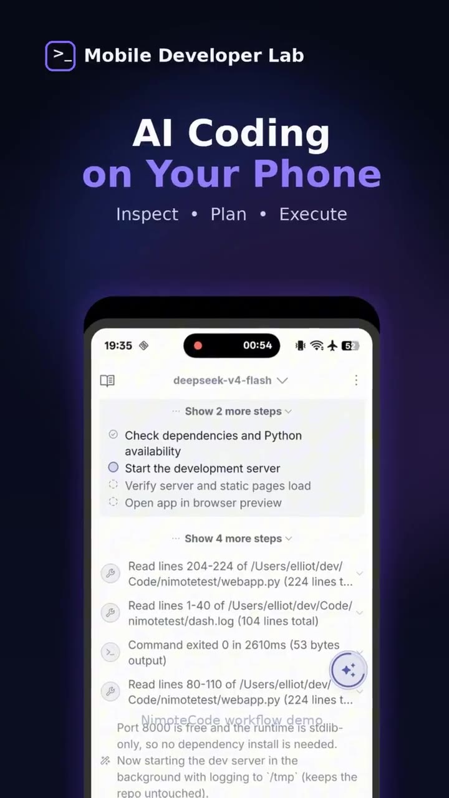

<p align="center">
  
</p>

<h1 align="center">NimoteCode</h1>

<p align="center">简体中文 · <a href="README.md">English</a></p>

<p align="center"><b>Android / iOS 移动 IDE</b><br>在手机和平板上连接开发主机、编辑代码、运行测试并审查 Git 改动。</p>

<p align="center">SSH · Code Editor · Terminal · Git · Debug · AI Agent<br>Android Local Linux（免 root，仅限 Android）</p>

<p align="center">商业闭源应用 · 本仓库提供官方文档、教程与社区资源，不包含应用源码。</p>

<p align="center">
  <a href="https://play.google.com/store/apps/details?id=com.nimote.nimotecode"></a>
  <a href="https://apps.apple.com/app/nimotecode-ssh-client-ide/id6776158253"></a>
</p>

<p align="center"><a href="#演示">观看演示</a> · <a href="https://nimotecode.com/zh/docs/quick-start">快速开始</a> · <a href="https://nimotecode.com/zh/">官网</a><br>Early Access Pro：登录后可在 Early Access 期间免费使用全部功能。</p>

<p align="center">
  
</p>

## 演示

<p align="center">
  <a href="https://github.com/user-attachments/assets/531d62fc-4874-41b9-96af-1ac9d2ad6fd6"></a>
</p>

[观看 AI Agent 产品演示](https://github.com/user-attachments/assets/531d62fc-4874-41b9-96af-1ac9d2ad6fd6) · [备用 MP4 视频](https://nimotecode.com/videos/ai-agent-demo-small.mp4)

## 为什么选择 NimoteCode？

**围绕已有项目继续工作。** 打开本地文件，或通过 SSH 连接开发主机。1.2.1–1.2.2 更新还支持通过系统选择器打开应用沙盒外的项目目录，并在重新启动后保留访问授权。

**修改之后，方便审查。** Git Diff、提交 Diff 与冲突可在横屏编辑器内打开；Explorer 与源代码管理会随文件变化刷新 Git 状态，便于在提交前检查结果。

**适应手机和平板上的操作。** 近期版本优化了面板布局、大屏可读性和终端键盘行为，并改善 SSH 在短暂中断时的连接韧性。长时间运行的任务仍建议使用主机上的持久会话。

**按任务选择运行环境与 AI 工具。** 将重型工具链留在 SSH 主机上，或在支持的 Android 设备上使用免 root 的 Local Linux；iOS 不支持 Local Linux。可以使用内置 Agent、接入兼容的 ACP Agent，或访问自己主机上的 Claude Code / Codex CLI；这些 CLI 并非内置，需要单独安装和认证。

具体版本变化见[发布说明](https://github.com/mobiledevloperlab/nimotecode/releases)。工作区与 AI 选项也包含早于 1.2.2 已提供的能力。

## 选择你的第一个开发任务

**打开项目 → 编辑 → 运行检查 → 审查 Git diff**

| 你想做什么 | 从哪里开始 | 适用条件 |
| --- | --- | --- |
| 修改远程项目并验证结果 | [SSH 远程开发](resources/remote-development-from-phone.md)：连接主机，编辑文件、运行测试并审查 diff | Android / iOS；需要可访问的开发主机 |
| 在手机上使用 AI 编程 CLI | [Claude Code on Phone](resources/claude-code-on-phone.md) 或 [Codex on Mobile](examples/codex-over-ssh/README.md)：通过 SSH 操作主机上的 CLI | CLI 需单独安装和认证，并非内置；服务访问权限与费用另计 |
| 在 Android 本机运行 Linux 工具 | [Android 免 root Linux](resources/android-linux-development.md)：打开 Ubuntu 环境并运行脚本 | 支持的 Android 8+ ARM64 / x86_64 设备；基于 PRoot，iOS 不支持 |

文件已在设备上？也可以从本地工作区开始编辑。语言工具链、LSP 和调试器所需工具取决于所选环境。

## 按你的习惯使用 AI

| 方式 | 如何工作 |
| --- | --- |
| **内置 Agent** | 理解项目上下文的助手，可结合文件、终端与 Git 信息。 |
| **ACP Agent** | 在 SSH 工作区接入兼容的外部 Agent，权限与进度集中在一条时间线中查看。 |
| **Claude Code / Codex** | 在自己的主机上运行，通过终端使用。 |

<details>
<summary>查看全部核心能力</summary>

| 模块 | 你可以做什么 |
| --- | --- |
| 资源管理器与搜索 | 浏览并搜索项目文件。 |
| 编辑器 | 编辑文件，并查看受支持语言的 LSP 诊断。 |
| 终端 | 在本地、Android 本地 Linux 或远程主机上运行命令与任务。 |
| Tasks | 运行并查看项目任务。 |
| 源代码管理 | 查看 Git 状态与 diff，进行提交、拉取与推送。 |
| 调试器 | 使用调试器逐步排查代码。 |
| 预览 | 预览网页输出，包括 HTML 快照。 |
| AI | 使用内置 Agent、ACP Agent，或经 SSH 使用 Claude Code / Codex。 |

</details>

## 开始使用 NimoteCode

[**Android — Google Play 下载**](https://play.google.com/store/apps/details?id=com.nimote.nimotecode) · [**iPhone / iPad — App Store 下载**](https://apps.apple.com/app/nimotecode-ssh-client-ide/id6776158253)

安装后，按[快速开始](https://nimotecode.com/zh/docs/quick-start)打开本地项目或连接 SSH 主机；支持的 Android 设备也可以选择 Local Linux。

## 移动开发指南

面向离开桌面环境的开发场景，覆盖本地、远程、Android Linux、Git 与 AI 工作流。

- [移动开发资源](resources/README.md) —— 完整指南索引
- [工作流示例](examples/README.md) —— SSH、Codex、Claude Code 与 Android 本地 Linux 配置
- [NimoteCode 文档](https://nimotecode.com/zh/docs/quick-start) —— 安装与功能参考

## Linux Presets

Android 本地 Linux 的可选环境预设（含版本化清单与校验脚本）位于独立仓库。

[Linux Presets](https://github.com/mobiledevloperlab/nimote-linux-presets) · [预设概览](presets/README.md) · [Android 本地 Linux 文档](https://nimotecode.com/zh/docs/local-linux)

## 最新更新

**1.2.2 亮点**

- 通过系统选择器打开应用沙盒外的项目目录。
- 在横屏编辑器内审查 Git diff、提交和冲突。
- 文件变化后自动刷新 Explorer 与源代码管理中的 Git 状态。

<details>
<summary>查看 1.1.5–1.2.2 的更多更新</summary>

### 1.2.1–1.2.2 重点更新

- **打开应用沙盒外的项目目录：** 在 Android 和 iPadOS/iPhone 上，可通过系统选择器打开应用自身文档目录之外的项目目录；NimoteCode 会记住授权，并通过安全的文件 Provider 读写。
- **横屏编辑器内的 Git 页面：** 在停靠式横屏工作区中，Git Diff、提交 Diff 与冲突解决页面直接在编辑器区域打开，与设置页、Markdown 预览位置一致。
- **近乎实时的 Git 状态：** Explorer 装饰与源代码管理会随终端、Explorer 或外部工具引起的文件变化即时更新，而不再等待轮询。
- **更统一、更聚焦的 IDE：** 面板、标签页、编辑器 Chrome、终端表面与 AI 视图共享统一的视觉系统，横屏工作区更聚焦，大屏可读性更好。
- **更精细的默认值与可靠性：** 更紧凑的 Explorer 默认值、点击不再收起键盘的 “/” 终端预置、可承受短暂中断的 SSH 会话，新安装默认使用英文。

### 1.1.5–1.2.0 重点更新

从 1.1.5 到 1.2.0，NimoteCode 围绕 Android 与 iOS 的移动开发体验完成了多项重要更新：

- **更完整的移动工作区：** 支持编辑器双栏分屏、应用内浏览器与媒体预览、Git 历史和 Diff 审查，并提升终端与 SSH 工作流的可靠性。
- **AI 与 Agent 工作流：** AI 工作区提供更丰富的上下文和最近任务、全局 Agent 状态提示、外部 ACP Agent、斜杠命令，并让 Claude Code、Codex 等工具共享一致的远程环境。
- **Android 本地 Linux：** 在支持的 Android 设备上，可免 root 使用包含 Bash、Git 和 SSH 的 Ubuntu 环境；iOS 暂不支持此功能。
- **更精细的移动界面：** 布局会根据可用空间自适应；界面缩放、Explorer 显示偏好、主题与 AI 时间线让信息更清晰、操作更可控。
- **更好的触控与键盘编辑：** Android 平板和 iPad 可使用 Monaco；手机继续使用 Nimote Editor，文本选择、剪贴板、Diff、外接键盘、CJK 输入与软键盘处理均有提升。

</details>

🗒️ [查看发布说明](https://github.com/mobiledevloperlab/nimotecode/releases)

## 社区

NimoteCode 持续迭代。欢迎提交问题、Bug 或建议，你的反馈将帮助改进产品。

💬 [Discord](https://discord.gg/tTxbpqYmhR) · [GitHub Issues](https://github.com/mobiledevloperlab/nimote_issues/issues) · [X](https://x.com/mobiledevlab)

⭐ Star 本仓库，关注 NimoteCode 与新的移动开发资源。

[](https://github.com/mobiledevloperlab/nimotecode)

## 关于本仓库

NimoteCode 是商业闭源应用。本公共仓库是以下内容的官方入口：

- 产品文档
- 移动开发指南
- 工作流示例
- Android Linux 预设
- 发布说明
- 社区 Issue 与反馈

NimoteCode 应用源码不在此仓库发布。已公开的 Local Linux 源码包与许可声明属于第三方组件，不代表 NimoteCode 应用开源。

<details>
<summary>维护本站文档</summary>

在本地构建网站与文档：

```bash
npm ci
npm run docs:build
npm run docs:check
```

使用 `npm run docs:dev` 在本地预览。

</details>

## 许可证

除非另有声明，内容为网站与文档。 [本地 Linux 源码与许可证](https://nimotecode.com/zh/docs/local-linux-source) · Linux Presets：[MIT](https://github.com/mobiledevloperlab/nimote-linux-presets/blob/master/LICENSE)。
